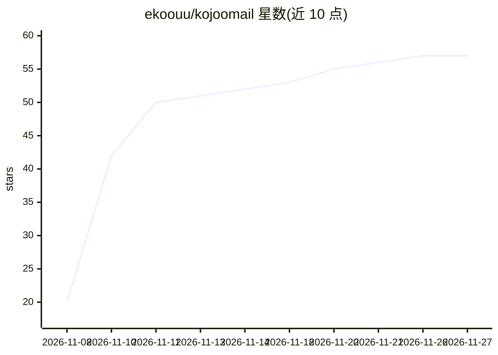

# ekoouu/kojoomail

⭐ 57 · Rust · AGPL-3.0 · 推送 2026-11-17 · [GitHub](https://github.com/ekoouu/kojoomail) · [官网](https://mail.songxxai.com/kojoomail/) · 个人维护 · 中文 README

**多账号合一收件箱的本地优先桌面邮件客户端，带 AI 批注与起草**

基于 Tauri 2 + Rust + React 的桌面邮件客户端（Windows 10/11、macOS 11+），支持 QQ、网易、Gmail、Outlook、iCloud 及任意 IMAP 邮箱聚合到一个按时间合并的收件箱。AI 部分需用户自配密钥（兼容 OpenAI 接口，DeepSeek、通义千问、Kimi、OpenAI 有现成选项）：为每封新邮件生成摘要分类、要点卡片、待办与建议回复，提供今日简报、邮件翻译和搜索框问答；也可不配 AI 当纯多账号客户端使用。邮件数据只存本地，验证码识别与通知分类用本地规则不调用模型；另提供只读 MCP 通道供外部 Agent 检索邮件。

## 筛选速览

| 维度 | 判定 | 备注 |
|---|---|---|
| AI 角色 | `ai-enhanced` | 去掉 AI 部分产品仍成立 |
| 许可风险 | `dual` | AGPL-3.0 |
| 部署形态 | `desktop` | 安装包/桌面程序 |
| 模型依赖 | — | README 未给出锁定关系 |
| 硬件要求 | — | 无带数字的原话,不猜 |
| 安装摩擦 | `medium` | 含编译或系统依赖之一 |
| 成熟度 | — | 结构信号不足 |

## 能力要点

- 多邮箱账号聚合收件箱，回信自动匹配发信身份
- AI 批注：一句话摘要分类、要点卡片、待办、按来信语言起草回复
- 本地优先：邮件只存本机，AI 用用户自己的密钥，可按账号关闭 AI
- 只读 MCP 接口供 Claude Desktop、Cursor 等外部 Agent 搜索邮件

## 适用场景

- 在单一窗口管理 QQ、Gmail、Outlook 等多个邮箱账号
- 外贸或跨境场景下让 AI 先读英文询盘并起草回复
- 从邮件自动提取待办、发票台账并按项目归集导出

## 场景标签

`AI 写作` `文档问答` · 领域:内容生成

## 证据(README 行号)

> L107: 不配 AI 也能用：它就是一个干净、省资源的多账号邮件客户端。
> L103: 在「设置 → AI 与模型」选一个服务商，填上你自己的密钥就能用。任何兼容 OpenAI 接口的服务都可以：DeepSeek、通义千问、Kimi、OpenAI 有现成选项，其他兼容接口（包括你自己部署的模型）填地址就行。每天有分

## 星数曲线

2026-11-08 20 → 2026-11-27 57（+37）

---
*卡片 v1 · prompt 1.4 · 生成 2026-11-18 · 置信度 high · 依据 README sha `ebb636ee41ae` · [字段定义](../../DATASET.md)*
