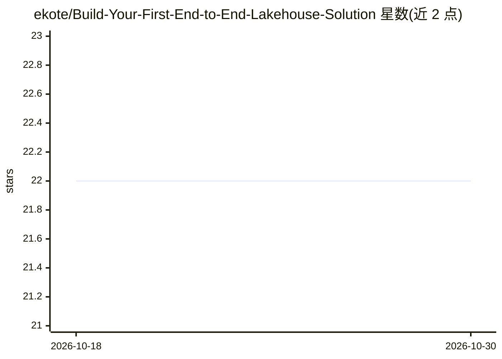

# ekote/Build-Your-First-End-to-End-Lakehouse-Solution

⭐ 22 · Jupyter Notebook · 推送 2025-11-18 · [GitHub](https://github.com/ekote/Build-Your-First-End-to-End-Lakehouse-Solution) · [官网](https://events.pinetool.ai/3499/#sessions/113278?referrer%5Bpathname%5D=%2Fsessions&referrer%5Bsearch%5D=&referrer%5Btitle%5D=Sessions) · 个人维护

**Microsoft Fabric 端到端 Lakehouse 动手工作坊教程**

Big Data Conference Europe 2025（维尔纽斯）的研讨会仓库，指导参会者用 Microsoft Fabric 构建完整 lakehouse 方案：通过 pipelines、dataflows、notebooks 与 Spark 完成数据接入、转换与服务，案例为分析纽约出租车数据以支持城市规划与交通安全。议程含 5 个练习，覆盖数据接入、Spark 转换与 Data Wrangler、SQL 分析、Power BI 数据消费及最新 Fabric 功能。参会者通过电子表格领取 Fabric 登录凭据，并提供 WhatsApp 群组交流。

## 筛选速览

| 维度 | 判定 | 备注 |
|---|---|---|
| AI 角色 | `ai-knowledge` | 知识聚合/清单类 |
| 许可风险 | `none` | — |
| 部署形态 | `None` |  |
| 模型依赖 | — | README 未给出锁定关系 |
| 硬件要求 | — | 无带数字的原话,不猜 |
| 安装摩擦 | `low` | 无编译、无系统依赖或容器化 |
| 成熟度 | — | 结构信号不足 |

## 能力要点

- 基于 Microsoft Fabric 的完整 lakehouse 构建流程（接入/准备/服务）
- 以纽约出租车数据为案例的城市交通分析项目
- 5 个渐进练习：数据接入、Spark 转换、Pipeline、Power BI、新功能
- 提供 Fabric 登录凭据领取方式与 WhatsApp 交流群

## 适用场景

- 跟随研讨会学习 Microsoft Fabric 数据工程
- 动手搭建含 Data Factory、Dataflows、Spark 的 lakehouse 方案
- 了解 lakehouse 上 BI 分析师与数据科学家的协作方式

## 场景标签

`教程课程` · 领域:学习与行业

## 证据(README 行号)

> L5: This workshop gives you practical, hands-on experience in building a complete lakehouse solution using Microsoft Fab
> L11: - Master Microsoft Fabric Data Integration and Data Engineering.
> L41: > 9:45 am - 10:50 am - Exercise 1 - Data Ingestion Foundations

## 星数曲线

2026-10-18 22 → 2026-10-30 22（+0）

---
*卡片 v1 · prompt 1.4 · 生成 2026-10-27 · 置信度 high · 依据 README sha `7cb6500c9c7f` · [字段定义](../../DATASET.md)*
