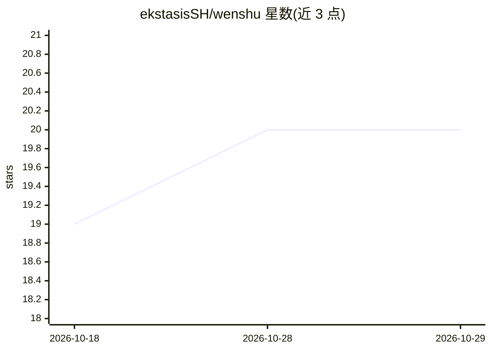

# ekstasisSH/wenshu

⭐ 20 · Python · MIT · 推送 2026-08-23 · [GitHub](https://github.com/ekstasisSH/wenshu) · 个人维护 · 中文 README

**面向人文社科研究的本地知识库/RAG/引文/理论谱系 AI 工作流**

以 skill 形式运行于 CodeBuddy / WorkBuddy 等 agent 工具的知识处理工作流：将 PDF/EPUB/DOCX 文献入库，注入段落级 Block ID 锚点，提供 GB/T 7714 引文格式化、来源/发展/争论三类关系的谱系图谱，以及自研模式 D 检索问答（embedding API + numpy 余弦 + 图谱增强 + 锚点溯源）。面向人文社科研究生、本科生与科研人员。文献导入与引文格式化无需 API key，检索问答需配置 Embedding key（默认 DeepSeek + 硅基流动 bge-m3），本地优先，MIT 许可。

## 筛选速览

| 维度 | 判定 | 备注 |
|---|---|---|
| AI 角色 | `ai-native` | 本体是模型或模型工具 |
| 许可风险 | `permissive` | MIT |
| 部署形态 | `None` |  |
| 模型依赖 | — | README 未给出锁定关系 |
| 硬件要求 | — | 无带数字的原话,不猜 |
| 安装摩擦 | `low` | 无编译、无系统依赖或容器化 |
| 成熟度 | — | 结构信号不足 |

## 能力要点

- PDF/EPUB/DOCX 入库与段落级锚点注入，引文可溯源
- GB/T 7714-2025 引文核验排版 + BibTeX
- 自研模式 D 检索问答：向量召回 + 谱系图谱增强 + 锚点溯源
- 图尔敏模型论点-证据链标注与知识库巡检工具

## 适用场景

- 把整本专著 PDF 入库为可检索知识库并做溯源问答
- 将参考文献核验并格式化为 GB/T 7714 或 BibTeX
- 梳理某概念的来源/发展/争论理论谱系

## 场景标签

`知识库管理` `知识图谱` `科研工具` `文档问答` · 领域:知识与检索

## 证据(README 行号)

> L3: 面向人文社科研究的 AI 知识处理工作流（skill 体系），运行于 CodeBuddy / WorkBuddy 等国产 agent 工具。
> L13: 面向人文社科研究生、高年级本科生，以及有文献管理需求的教师和科研人员。

## 星数曲线

2026-10-18 19 → 2026-10-29 20（+1）

---
*卡片 v1 · prompt 1.4 · 生成 2026-10-28 · 置信度 high · 依据 README sha `713fe5a0ccc2` · [字段定义](../../DATASET.md)*
