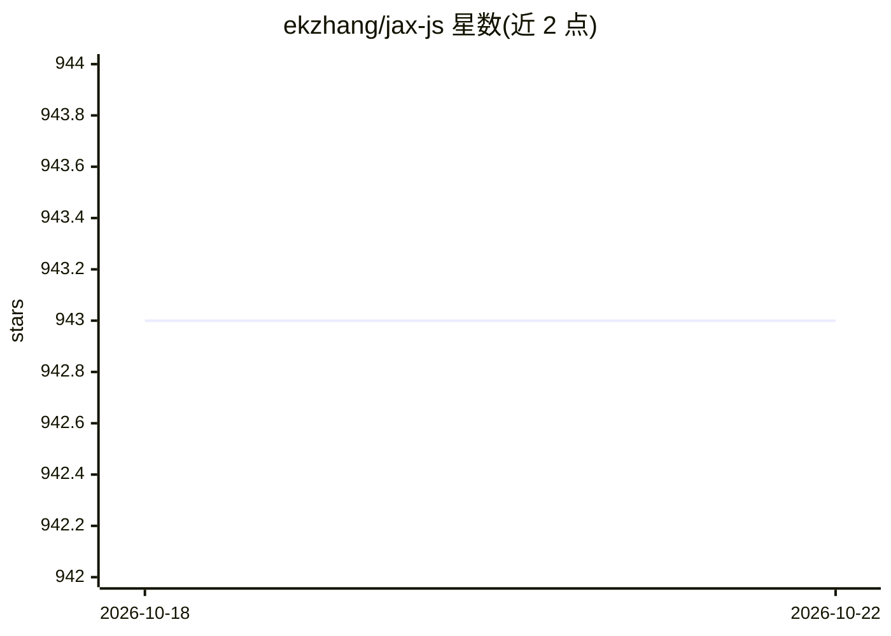

# ekzhang/jax-js

⭐ 944 · TypeScript · MIT · 推送 2026-10-21 · [GitHub](https://github.com/ekzhang/jax-js) · [官网](https://jax-js.com) · 个人维护

**面向开发者的浏览器端 JAX 风格机器学习框架（WebGPU/Wasm）**

用纯 JavaScript 从零实现的机器学习/数值计算框架，把数组运算编译为 WebAssembly 与 WebGPU 内核，在浏览器、Node.js、Deno 中客户端运行。保持与 NumPy/JAX 接近的 API，支持 grad/jvp/vmap/jit 等可组合变换，提供 cpu/wasm/webgpu/webgl 四种设备后端，附 @jax-js/loaders（safetensors、BPE）、onnx 模型加载、optax 优化器等配套库。零外部依赖，需要手动管理引用计数内存模型；作者声明项目仍处早期阶段。通过 npm 安装。

## 筛选速览

| 维度 | 判定 | 备注 |
|---|---|---|
| AI 角色 | `ai-ecosystem` | LLM/agent 周边工具 |
| 许可风险 | `permissive` | MIT |
| 部署形态 | `library` | 以包/库形式分发 |
| 模型依赖 | — | README 未给出锁定关系 |
| 硬件要求 | — | 无带数字的原话,不猜 |
| 安装摩擦 | `low` | 无编译、无系统依赖或容器化 |
| 成熟度 | `idea` | |

## 能力要点

- 将数组运算编译为 WebAssembly 与 WebGPU 内核，客户端运行
- 支持 grad/jvp/vmap/jit 组合变换与 JsTree（类 pytree）
- 4 种设备后端：cpu/wasm/webgpu/webgl，跨主流浏览器与 Node.js/Deno
- 配套库：safetensors/BPE 加载、ONNX 模型加载、Adam/SGD 优化器

## 适用场景

- 在网页中直接运行神经网络训练与推理，无需服务器
- 把 JAX/NumPy 风格的数值计算代码移植到 JavaScript
- 构建浏览器内的 ML 演示、可视化与交互应用

## 场景标签

`推理引擎` · 领域:训练与推理

## 证据(README 行号)

> L8: **jax-js** is a machine learning framework for the browser. It aims to bring
> L9: JAX-style, high-performance CPU and GPU kernels to JavaScript, so you can run
> L16: Under the hood, it translates array operations into a compiler representation, then synthesizes
> L17: kernels in WebAssembly and WebGPU.

## 星数曲线

2026-10-18 943 → 2026-10-22 943（+0）

---
*卡片 v1 · prompt 1.4 · 生成 2026-10-21 · 置信度 high · 依据 README sha `5de471a4090a` · [字段定义](../../DATASET.md)*
