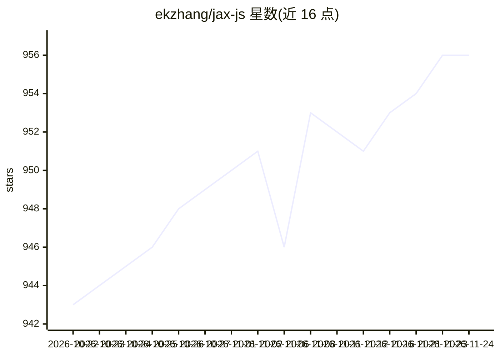

# ekzhang/jax-js

⭐ 956 · TypeScript · MIT · 推送 2026-11-21 · [GitHub](https://github.com/ekzhang/jax-js) · [官网](https://jax-js.com) · 个人维护

**浏览器端 JAX 风格 ML 库，运行于 WebGPU 与 Wasm**

纯 JavaScript 编写的浏览器机器学习框架，将数组操作翻译为编译器表示，在 WebAssembly 与 WebGPU 上生成内核。保持与 NumPy/JAX 兼容的 API，提供 grad/vmap/jit 组合变换、自动微分与内核融合。零外部依赖，客户端运行，支持 CPU(Wasm)、WebGPU、WebGL 等后端设备，附 ONNX 加载、safetensors 读取与优化器等辅助包。需要遵循引用计数内存模型。

## 筛选速览

| 维度 | 判定 | 备注 |
|---|---|---|
| AI 角色 | `ai-ecosystem` | LLM/agent 周边工具 |
| 许可风险 | `permissive` | MIT |
| 部署形态 | `library` | 以包/库形式分发 |
| 模型依赖 | — | README 未给出锁定关系 |
| 硬件要求 | — | 无带数字的原话,不猜 |
| 安装摩擦 | `low` | 无编译、无系统依赖或容器化 |
| 成熟度 | `idea` | |

## 能力要点

- 支持 grad/vmap/jit 等 JAX 风格可组合变换与内核融合
- 后端覆盖 Wasm、WebGPU、WebGL 与调试用 JS CPU 四种设备
- 零外部依赖，读取 safetensors、支持 ONNX 部分模型
- 配套 @jax-js/loaders、onnx、optax 辅助库

## 适用场景

- 在浏览器中训练神经网络（如 MNIST）
- 浏览器内运行 LLM 与语音识别模型
- 网页端做可微分数值计算与科学可视化
- GRPO 强化学习微调等实验在浏览器完成

## 场景标签

 · 领域:机器学习框架/Web

## 证据(README 行号)

> L8: **jax-js** is a machine learning framework for the browser. It aims to bring
> L16: Under the hood, it translates array operations into a compiler representation, then synthesizes
> L275: Similar to JAX, jax-js has a concept of "devices" which are a backend that stores Arrays in memory

## 星数曲线

2026-10-22 943 → 2026-11-24 956（+13）

---
*卡片 v1 · prompt 1.4 · 生成 2026-11-24 · 置信度 high · 依据 README sha `54cdac9778fc` · [字段定义](../../DATASET.md)*
