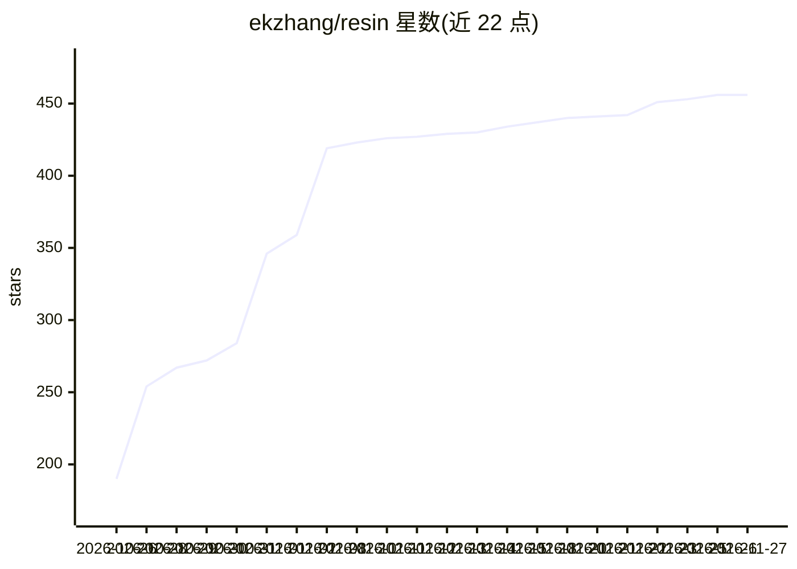

# ekzhang/resin

⭐ 456 · Python · Apache-2.0 · 推送 2026-11-23 · [GitHub](https://github.com/ekzhang/resin) · 个人维护

**为开发者提供构建 LLM 推理引擎的组件库**

以 Rust 编写的批调度器、KV 缓存池与指标服务器为核心，用户自行编写模型前向 kernel 组成完整推理引擎，流程为 token ID 经 Rust Engine 生成冻结 BatchPlan 后交由 Python Runner 执行。提供可选 HTTP 服务（兼容 OpenAI/Anthropic 接口）、Prometheus 指标、投机解码、TP/EP/CP/DP 并行与 CUDA graph。README 明确声明非生产级软件，定位为研究推理系统、新模型与新硬件的实验基础。安装需 Python 3.11+ 与 Rust。

## 筛选速览

| 维度 | 判定 | 备注 |
|---|---|---|
| AI 角色 | `ai-ecosystem` | LLM/agent 周边工具 |
| 许可风险 | `permissive` | Apache-2.0 |
| 部署形态 | `library` | 以包/库形式分发 |
| 模型依赖 | — | README 未给出锁定关系 |
| 硬件要求 | — | 无带数字的原话,不猜 |
| 安装摩擦 | `medium` | 含编译或系统依赖之一 |
| 成熟度 | `idea` | |

## 能力要点

- headless Rust Engine：批调度器、统一 slab 缓存池与指标服务器
- 支持 TP/EP/CP/DP Attention 并行与 prefill/decode CUDA graphs
- 内置 HTTP 服务器暴露 OpenAI/Anthropic 兼容端点与演示页面
- 提供 MLX runner，可在 Apple Silicon 上运行模型

## 适用场景

- 为自定义模型从零搭建独立推理引擎
- 在本地 GPU 或 Modal 云端做模型 benchmark 与服务检查
- 在 Apple Silicon 上以 MLX 后端本地运行小模型

## 场景标签

`推理引擎` · 领域:训练与推理

## 证据(README 行号)

> L3: Resin is not an inference engine. It's a library of _building blocks_ for LLM
> L6: At its core is the headless `Engine`: a fast Rust scheduler, KV cache, and
> L20: > inference engine, please use SGLang or vLLM. Read on if you want to hack on

## 星数曲线

2026-10-26 190 → 2026-11-27 456（+266）

---
*卡片 v1 · prompt 1.4 · 生成 2026-11-25 · 置信度 high · 依据 README sha `7a6531a97764` · [字段定义](../../DATASET.md)*
