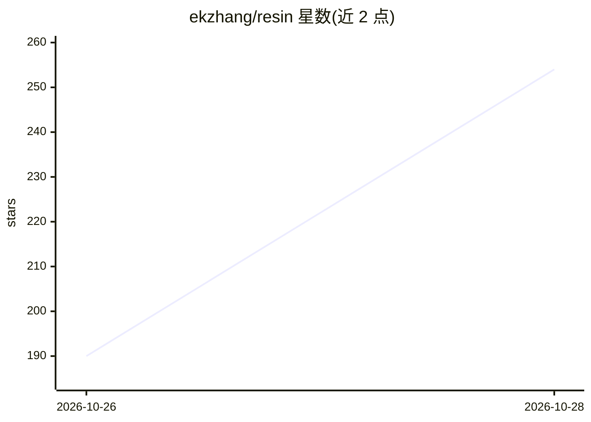

# ekzhang/resin

⭐ 254 · Python · Apache-2.0 · 推送 2026-10-26 · [GitHub](https://github.com/ekzhang/resin) · 个人维护

**构建 LLM 推理引擎的积木式库：Rust 调度器+自写 kernel**

实验性库，自身不是推理引擎：提供 Rust 编写的 headless Engine（批调度、KV/SWA/循环状态统一缓存池、投机解码、TP/EP/CP/DP 并行、Prometheus 指标）与可选 HTTP 服务，用户为特定模型和硬件编写前向 kernel。模型 runner 是独立包（CUDA 优化版与 Torch 参考版），配套基准 CLI、Modal 部署脚本、服务器正确性检查脚本与 agent 技能。README 明确声明非生产级软件，建议需要现成引擎者改用 SGLang 或 vLLM。安装需 Python 3.11+ 与 Rust，pip 从 GitHub 构建本地 Rust 扩展。

## 筛选速览

| 维度 | 判定 | 备注 |
|---|---|---|
| AI 角色 | `ai-ecosystem` | LLM/agent 周边工具 |
| 许可风险 | `permissive` | Apache-2.0 |
| 部署形态 | `library` | 以包/库形式分发 |
| 模型依赖 | — | README 未给出锁定关系 |
| 硬件要求 | — | 无带数字的原话,不猜 |
| 安装摩擦 | `medium` | 含编译或系统依赖之一 |
| 成熟度 | `idea` | |

## 能力要点

- Rust 批调度引擎：slab 统一缓存池、投机解码（MTP/DSpark）、零开销 overlap 调度
- 模型特定的前向 kernel 由用户编写，TP/EP/CP/DP Attention 并行
- 原生 HTTP 服务支持 OpenAI Chat/Responses、Anthropic Messages 协议
- 单一自定义 runner 只需实现一个方法（numpy token 进出）

## 适用场景

- 为新模型或新硬件从零构建定制推理引擎
- 研究 LLM 推理系统调度与 KV 缓存机制
- 在 Modal 上部署基准测试各模型的 prefill/decode 表现

## 场景标签

`推理引擎` · 领域:训练与推理

## 证据(README 行号)

> L3: Resin is not an inference engine. It's a library of _building blocks_ for LLM
> L6: At its core is the headless `Engine`: a fast Rust scheduler, KV cache, and
> L7: metrics server. You then write the forward pass as **model-specific kernels,

## 星数曲线

2026-10-26 190 → 2026-10-28 254（+64）

---
*卡片 v1 · prompt 1.4 · 生成 2026-10-27 · 置信度 high · 依据 README sha `ab013aa67771` · [字段定义](../../DATASET.md)*
