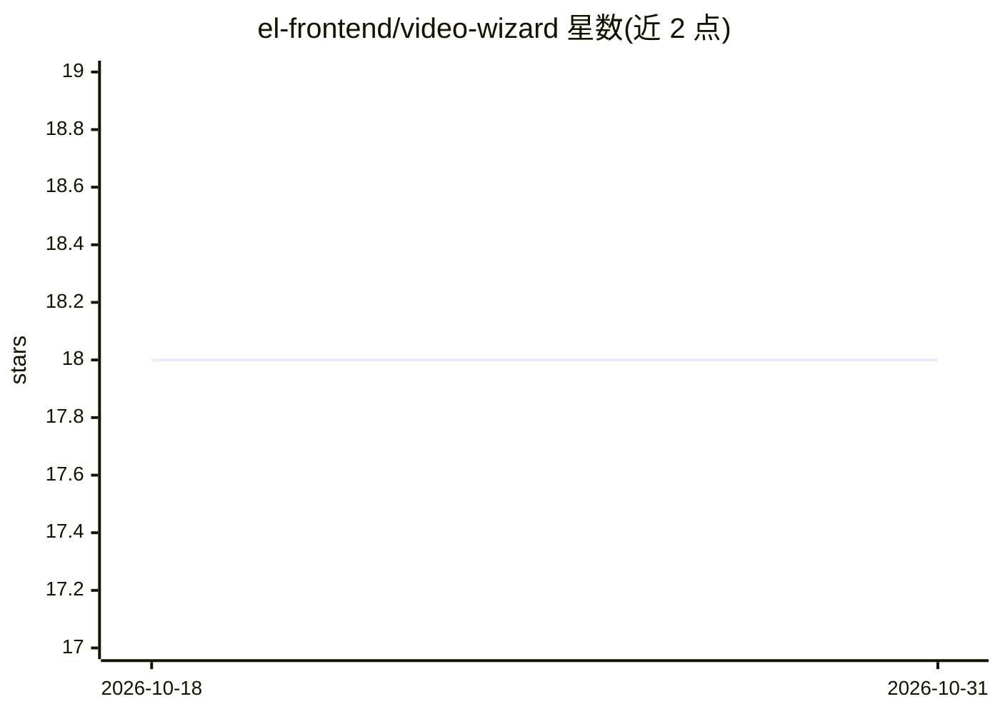

# el-frontend/video-wizard

⭐ 18 · TypeScript · MIT · 推送 2026-10-27 · [GitHub](https://github.com/el-frontend/video-wizard) · 组织维护

**自托管短视频 AI 工具箱：找爆款片段、Whisper 字幕、渲染竖版视频**

面向短视频创作者的自托管 Web 应用：上传或粘贴 YouTube 视频，经 Whisper 转录，可由 GPT-4o 对 30-90 秒片段打分选出爆款候选，再通过 Remotion 渲染 9:16 等多比例成片；也支持仅粘贴转录文本做爆款分析。架构为 Next.js 16 前端 + FastAPI 处理引擎（Whisper/FFmpeg/MediaPipe）+ Remotion 渲染服务，PostgreSQL 支撑任务队列（无 Redis），Auth.js 邮箱+bcrypt 认证。一条 docker compose 命令启动，需 Docker 与 OPENAI_API_KEY。README 注明字幕生成流程最完整。

## 筛选速览

| 维度 | 判定 | 备注 |
|---|---|---|
| AI 角色 | `ai-native` | 本体是模型或模型工具 |
| 许可风险 | `permissive` | MIT |
| 部署形态 | `self-host` | docker 或自建部署 |
| 模型依赖 | — | README 未给出锁定关系 |
| 硬件要求 | — | 无带数字的原话,不猜 |
| 安装摩擦 | `low` | 无编译、无系统依赖或容器化 |
| 成熟度 | — | 结构信号不足 |

## 能力要点

- Whisper 转录 + 9 套字幕模板 + Remotion 渲染
- GPT-4o 打分筛选 30-90 秒爆款片段
- Postgres 任务队列带重试/退避，无 Redis 依赖
- 支持 9:16/1:1/4:5/16:9 多种输出比例与品牌套件

## 适用场景

- 把长视频批量转成 TikTok/Reels/Shorts 竖版短视频
- 为视频自动生成并编辑样式化字幕
- 不依赖 SaaS 自托管短视频生产流水线

## 场景标签

`语音识别` `图像视频处理` · 领域:感知与多模态

## 证据(README 行号)

> L28: |**Subtitle Generator**|`/subtitle-generator`|Upload or paste YouTube → transcribe (Whisper) → edit subtitles → pic
> L29: |**Video Wizard**|`/video-wizard`|Full pipeline: transcribe → GPT-4o scores 30-90s viral clips → render the winners

## 星数曲线

2026-10-18 18 → 2026-10-31 18（+0）

---
*卡片 v1 · prompt 1.4 · 生成 2026-10-29 · 置信度 high · 依据 README sha `2a468230e915` · [字段定义](../../DATASET.md)*
