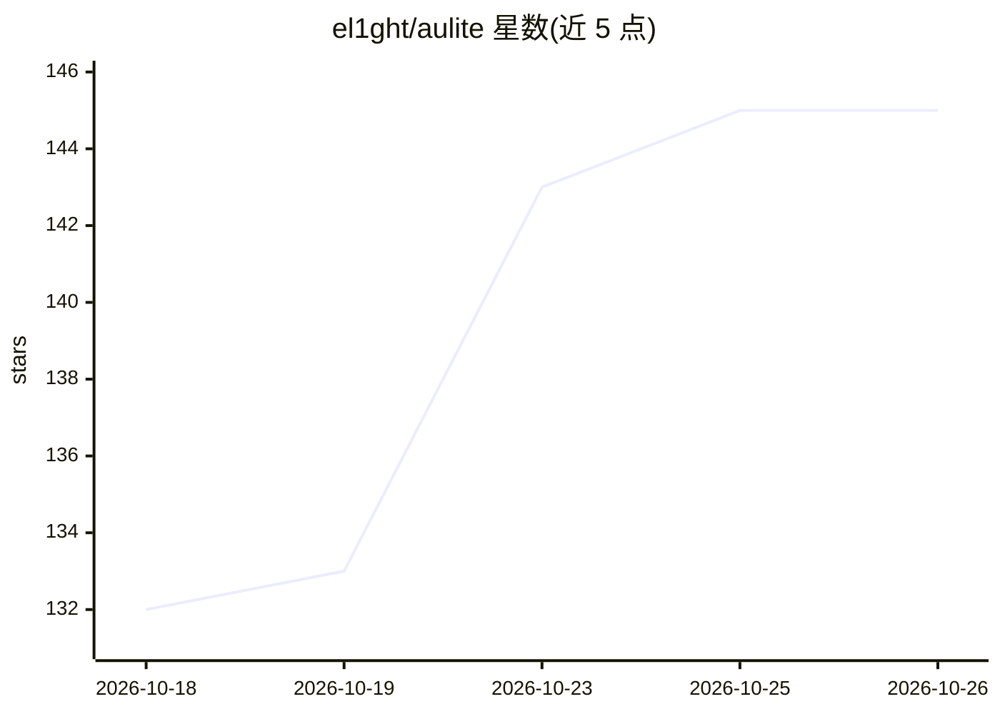

# el1ght/aulite

⭐ 145 · TypeScript · NOASSERTION · 推送 2026-06-14 · [GitHub](https://github.com/el1ght/aulite) · 个人维护

**面向 EU AI Act 的 AI 流量合规代理：审计与报告**

部署在应用与 AI 供应商之间的自托管 HTTP 代理：应用只需改一个 base_url，代理即分析每次请求/响应的合规风险（143 条关键词规则覆盖 8 个 Annex III 高风险领域、11 种欧洲 PII 模式、可选 LLM 语义判定），写入 SHA-256 哈希链防篡改审计日志（SQLite），并生成 Art. 12/27/72/73 对应的 PDF 报告。支持 OpenAI/Anthropic/Azure 及任意 OpenAI 兼容 API，含实时仪表盘；确定性检查开销声明低于 5ms，以 Docker 单容器分发。

## 筛选速览

| 维度 | 判定 | 备注 |
|---|---|---|
| AI 角色 | `ai-ecosystem` | LLM/agent 周边工具 |
| 许可风险 | `none` | NOASSERTION |
| 部署形态 | `self-host` | docker 或自建部署 |
| 模型依赖 | local-ok | 支持本地模型 |
| 硬件要求 | — | 无带数字的原话,不猜 |
| 安装摩擦 | `low` | 无编译、无系统依赖或容器化 |
| 成熟度 | — | 结构信号不足 |

## 能力要点

- 143 条规则覆盖 EU AI Act 8 个 Annex III 高风险领域
- SHA-256 哈希链防篡改审计日志，可通过 /verify 端点独立校验
- 生成 Art. 12/27/72/73 四类 PDF 合规报告与 FRIA 草稿
- 支持 OpenAI/Anthropic/Azure 及 OpenAI 兼容 API（Ollama、vLLM、LocalAI、llama.cpp）

## 适用场景

- 我需要让调用 LLM 的系统满足 EU AI Act 的日志与报告要求
- 监管检查前生成可审计的合规记录与 FRIA 草稿
- 实时监控 AI 交互中的禁止行为与 PII 泄露风险

## 场景标签

 · 领域:AI 治理/合规基础设施

## 证据(README 行号)

> L21: Aulite is a transparent HTTP proxy that sits between your application and any AI provider. It analyzes every reques
> L127: Client App  →  Aulite (:3000)  →  AI Provider

## 星数曲线

2026-10-18 132 → 2026-10-26 145（+13）

---
*卡片 v1 · prompt 1.4 · 生成 2026-10-23 · 置信度 mid · 依据 README sha `088b1205f70d` · [字段定义](../../DATASET.md)*
