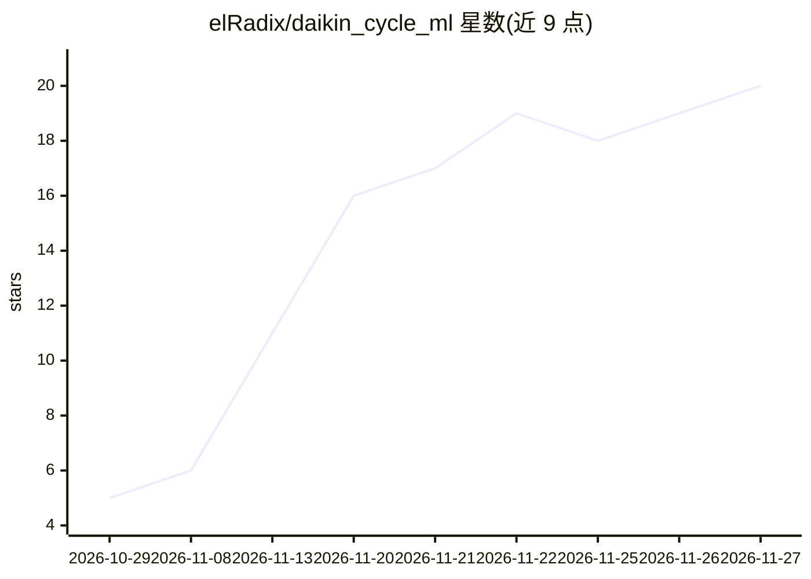

# elRadix/daikin_cycle_ml

⭐ 20 · Python · MIT · 推送 2026-11-23 · [GitHub](https://github.com/elRadix/daikin_cycle_ml) · 个人维护

**Home Assistant 用户检测并学习大金热泵循环异常的本地 ML 集成**

基于 ESPAltherma 传感器数据的 Home Assistant 自定义集成，读取大金 Altherma 热泵压缩机启停数据，进行循环检测、0-100 评分、分模式 COP 计算与季节 SPF 统计。内置逐安装学习的机器学习机制：12 维特征向量、EWMA 基线、自适应阈值、每周 k-means 聚类与 Z-score 异常检测。提供 19 类告警与多张 Lovelace 仪表盘卡片，全部本地运行、不连云端。安装依赖 HACS 且要求 HA 2026.9+ 与 Python 3.14。

## 筛选速览

| 维度 | 判定 | 备注 |
|---|---|---|
| AI 角色 | `ai-native` | 本体是模型或模型工具 |
| 许可风险 | `permissive` | MIT |
| 部署形态 | `None` |  |
| 模型依赖 | — | README 未给出锁定关系 |
| 硬件要求 | — | 无带数字的原话,不猜 |
| 安装摩擦 | `low` | 无编译、无系统依赖或容器化 |
| 成熟度 | — | 结构信号不足 |

## 能力要点

- 逐安装机器学习：EWMA 基线、自适应阈值、k-means 三类聚类、Z-score 异常检测
- 19 类可调告警，含独立去重窗口与静默时段
- 51 份大金数据表支持 COP 归一化对比
- 多张 Lovelace 仪表盘卡片随集成提供

## 适用场景

- 排查热泵频繁启停并获取调整建议
- 比较不同周期间的 COP 与硬件退化
- 接入 HA 能源仪表盘统计耗电

## 场景标签

 · 领域:智能家居/设备监控

## 证据(README 行号)

> L140: ### Per-installation machine learning
> L141: **12-dimensional feature vector** per cycle. **Per-mode EWMA baseline** with outlier skip. **Adaptive thresholds**
> L9: **Local-only. No cloud. No accounts.** Everything runs inside your Home Assistant box.

## 星数曲线

2026-10-29 5 → 2026-11-27 20（+15）

---
*卡片 v1 · prompt 1.4 · 生成 2026-11-18 · 置信度 high · 依据 README sha `8d00c86c2053` · [字段定义](../../DATASET.md)*
