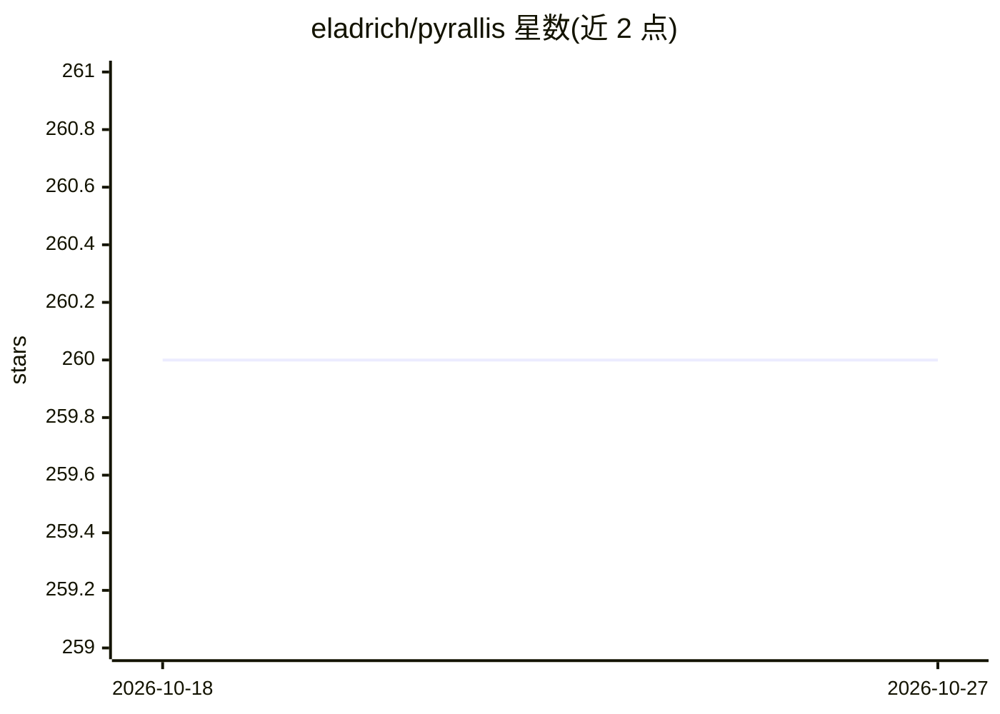

# eladrich/pyrallis

⭐ 260 · Python · MIT · 推送 2026-03-01 · [GitHub](https://github.com/eladrich/pyrallis) · [官网](https://eladrich.github.io/pyrallis/) · 个人维护

**用 dataclass 定义配置、从命令行与文件解析的 Python 库**

Pyrallis 是从 simple-parsing 派生、受 Hydra 启发的 Python 配置解析库：将预定义的 dataclass 自动转为命令行参数解析器，支持同时从命令行与 yaml/json/toml 配置文件读取（命令行优先覆盖文件）。提供 pyrallis.wrap 装饰器、嵌套与继承 dataclass 支持、从注释自动生成 --help、pyrallis.dump/load 序列化，以及可扩展的 encode/decode 类型注册机制。面向希望以类型化方式管理项目配置的 Python 开发者（含机器学习训练脚本场景）。限制：仅支持 Python dataclass 定义的配置结构。

## 筛选速览

| 维度 | 判定 | 备注 |
|---|---|---|
| AI 角色 | `ai-ecosystem` | LLM/agent 周边工具 |
| 许可风险 | `permissive` | MIT |
| 部署形态 | `library` | 以包/库形式分发 |
| 模型依赖 | — | README 未给出锁定关系 |
| 硬件要求 | — | 无带数字的原话,不猜 |
| 安装摩擦 | `low` | 无编译、无系统依赖或容器化 |
| 成熟度 | — | 结构信号不足 |

## 能力要点

- dataclass 直接映射为命令行参数解析器
- 命令行与配置文件（yaml/json/toml）联合读取，命令行优先
- 从 dataclass 注释自动生成 --help
- pyrallis.dump/load 序列化与 encode/decode 自定义类型扩展

## 适用场景

- 为训练脚本定义带类型提示和自动补全的配置结构
- 用同一套 dataclass 同时支持命令行覆盖与 yaml 配置文件
- 嵌套多级配置（如 compute/log 分组）的解析与导出

## 场景标签

 · 领域:开发者工具/配置管理

## 证据(README 行号)

> L13: `Pyrallis` is a simple library, derived from `simple-parsing` and inspired by `Hydra`, for automagically creating p
> L176: In our case, we were looking for a library that would support the vanilla `dataclass` without requiring dedicated 

## 星数曲线

2026-10-18 260 → 2026-10-27 260（+0）

---
*卡片 v1 · prompt 1.4 · 生成 2026-10-22 · 置信度 low · 依据 README sha `14d8a9dc84d8` · [字段定义](../../DATASET.md)*
