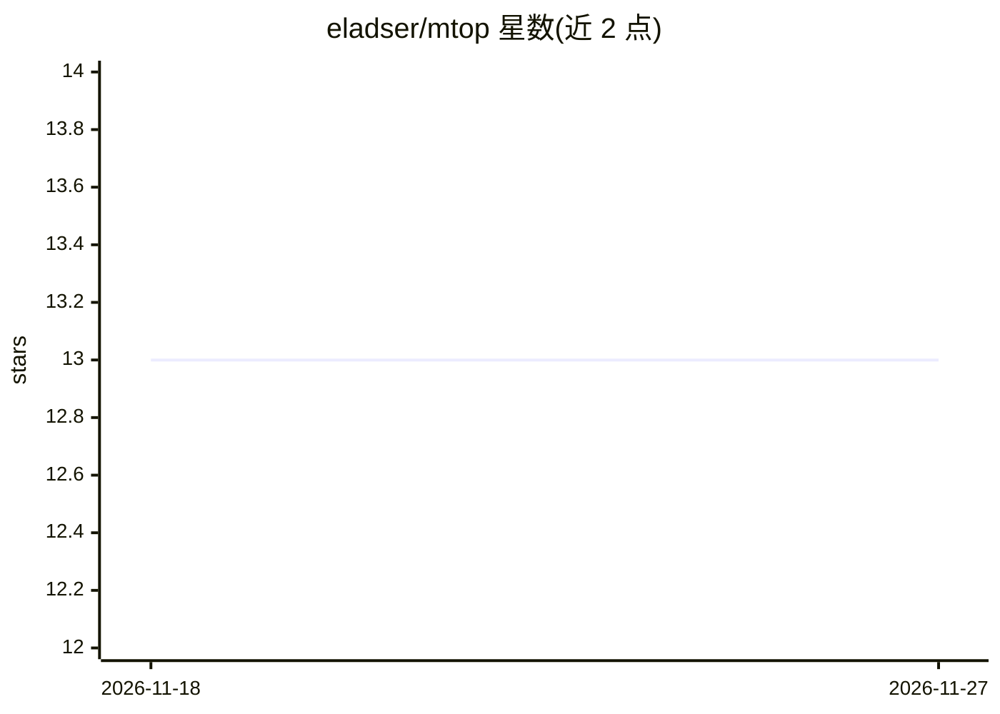

# eladser/mtop

⭐ 13 · Go · MIT · 推送 2026-11-17 · [GitHub](https://github.com/eladser/mtop) · 个人维护

**本地 LLM 服务的终端监控器：查看模型、VRAM、请求与 tok/s**

面向本地运行模型服务器（Ollama、llama.cpp、LM Studio、vLLM、llama-swap、Lemonade、SGLang）的 TUI 监控工具，用 Go 编写。显示已加载模型及其 VRAM 占用、GPU 状态与流式请求的 tok/s；通过本地直通代理读取响应流提取逐请求数据；支持手动卸载模型、自动清理逾期未卸载的闲置模型、多模型 tok/s 对比、GPU 功耗与能效估算，并可输出 Prometheus 格式 /metrics 供 Grafana 读取。无遥测，仅与本地服务器通信。

## 筛选速览

| 维度 | 判定 | 备注 |
|---|---|---|
| AI 角色 | `ai-ecosystem` | LLM/agent 周边工具 |
| 许可风险 | `permissive` | MIT |
| 部署形态 | `library` | 以包/库形式分发 |
| 模型依赖 | local-ok | 支持本地模型 |
| 硬件要求 | — | 无带数字的原话,不猜 |
| 安装摩擦 | `low` | 无编译、无系统依赖或容器化 |
| 成熟度 | — | 结构信号不足 |

## 能力要点

- TUI 实时展示模型、VRAM、GPU 与请求流 tok/s
- 本地直通代理读取响应流，提供逐请求计时数据
- 手动/自动卸载模型与慢速原因诊断（CPU offload、context 满、排队）
- mtop compare 对比多个模型的 tok/s，支持 Prometheus /metrics 输出

## 适用场景

- 监控本地跑的 Ollama/llama.cpp 等服务的 GPU 占用与请求
- 排查模型为什么慢：溢出到 CPU、上下文满、请求排队
- 清理 Ollama 未按期卸载的闲置模型释放 VRAM
- 对比几个模型在同一 GPU 上的生成速度

## 场景标签

`LLM 可观测性` · 领域:评测与运维

## 证据(README 行号)

> L1: mtop - htop for your local AI
> L9: One terminal window for whatever you're running locally (Ollama, llama.cpp, LM Studio, vLLM, llama-swap, Lemonade, S

## 星数曲线

2026-11-18 13 → 2026-11-27 13（+0）

---
*卡片 v1 · prompt 1.4 · 生成 2026-11-18 · 置信度 high · 依据 README sha `4e263095bd29` · [字段定义](../../DATASET.md)*
