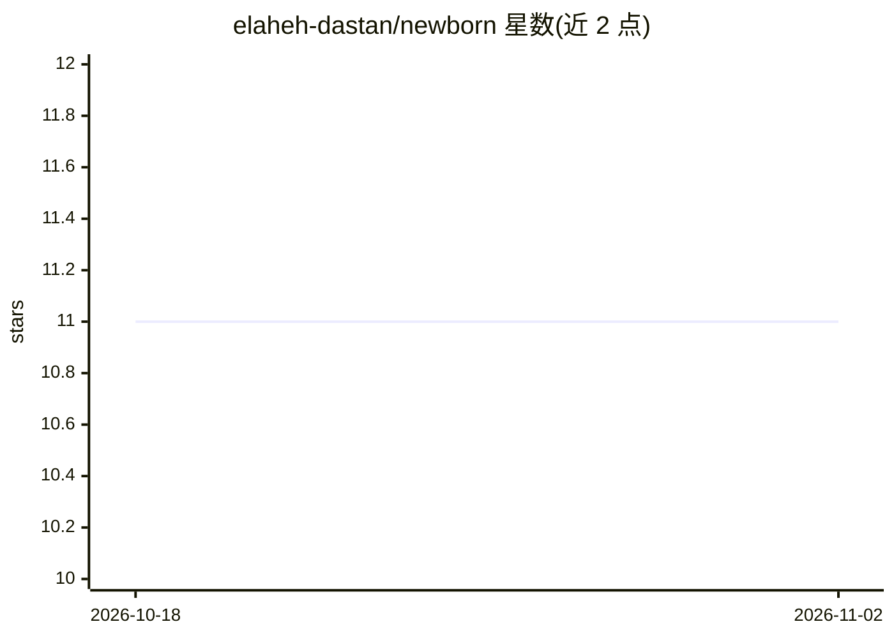

# elaheh-dastan/newborn

⭐ 11 · Go · MIT · 推送 2026-08-28 · [GitHub](https://github.com/elaheh-dastan/newborn) · 个人维护

**Go 泛型实现的经典机器学习算法库，供 Go 开发者使用**

基于 Go 泛型的经典机器学习算法库：提供 KNN、线性/逻辑/多项式回归、K-Means 聚类、高斯朴素贝叶斯、CART 决策树等模型，配套 CSV 数据读取、预处理（train/test 划分、k-fold、标准化、min-max）、评估指标（Accuracy/MSE/混淆矩阵）、描述统计与线性代数、距离度量包。数值数据支持 float32/float64，KNN 标签可为任意 comparable 类型。README 附带各算法的使用示例与数学说明。要求 Go 1.27+，MIT 许可。

## 筛选速览

| 维度 | 判定 | 备注 |
|---|---|---|
| AI 角色 | `ai-native` | 本体是模型或模型工具 |
| 许可风险 | `permissive` | MIT |
| 部署形态 | `None` |  |
| 模型依赖 | — | README 未给出锁定关系 |
| 硬件要求 | — | 无带数字的原话,不猜 |
| 安装摩擦 | `low` | 无编译、无系统依赖或容器化 |
| 成熟度 | — | 结构信号不足 |

## 能力要点

- 11 个包覆盖分类/回归/聚类/预处理/评估/统计/线性代数
- 基于 Go 泛型，数值支持 float32/float64，KNN 标签支持任意 comparable 类型
- 提供 k-fold 交叉验证与标准化/min-max 缩放等预处理
- README 附各算法代码示例与数学计算说明

## 适用场景

- 在 Go 项目中直接调用经典 ML 算法做分类或回归
- 学习经典机器学习算法的实现与数学原理
- 对小型数据集做聚类与评估分析

## 场景标签

 · 领域:机器学习/算法库

## 证据(README 行号)

> L6: This repository is really simple and small I tried to put only basic and most frequently ML algorithms in it, I'm go
> L17: |`knn`|K-Nearest Neighbours|classification|
> L18: |`regression`|Polynomial, Linear, Logistic regression|regression & classification|

## 星数曲线

2026-10-18 11 → 2026-11-02 11（+0）

---
*卡片 v1 · prompt 1.4 · 生成 2026-11-02 · 置信度 high · 依据 README sha `d87df97ed29c` · [字段定义](../../DATASET.md)*
