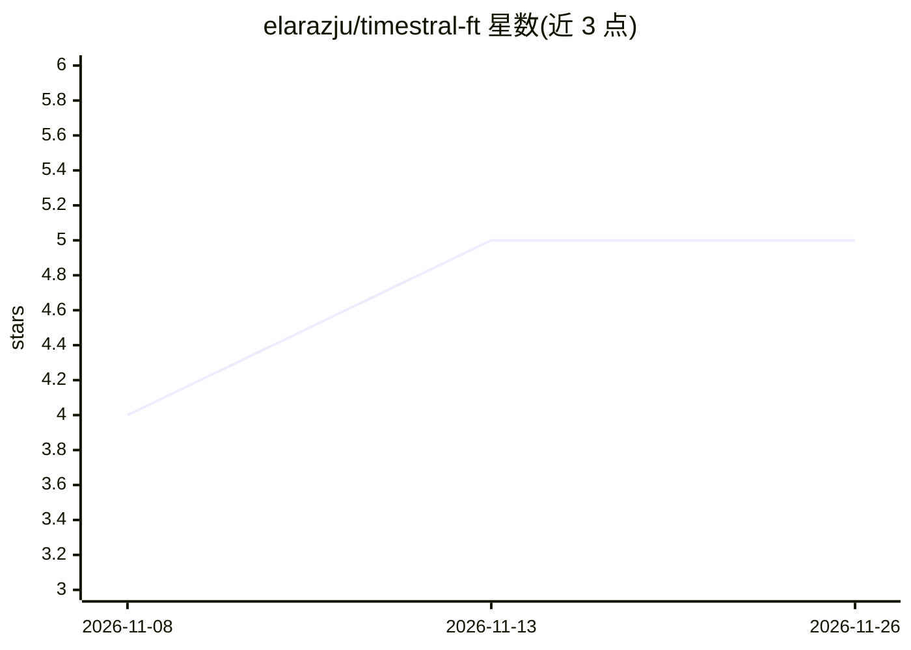

# elarazju/timestral-ft

⭐ 5 · Python · Apache-2.0 · 推送 2026-11-11 · [GitHub](https://github.com/elarazju/timestral-ft) · 个人维护 · 中文 README

**对 Timestral 时序基础模型做全参/LoRA 微调的工具包**

面向 Mistral AI Timestral 时序基础模型的社区微调工具包：通过 Python API 与 train/evaluate/export/predict 四个 CLI 命令，串联表格训练数据接入、验证、滚动回测与权重导出。支持全参数与 LoRA 微调、21 分位预测输出、MAE/MSE/RMSE/WQL 等指标、可恢复检查点与独立 LoRA 适配器导出。v0.1 仅单设备 FP32，训练视野限 1,024 步，不含分布式训练与预训练；项目独立于 Mistral AI，模型权重从 Hugging Face 下载且不随源码捆绑。

## 筛选速览

| 维度 | 判定 | 备注 |
|---|---|---|
| AI 角色 | `ai-native` | 本体是模型或模型工具 |
| 许可风险 | `permissive` | Apache-2.0 |
| 部署形态 | `library` | 以包/库形式分发 |
| 模型依赖 | — | README 未给出锁定关系 |
| 硬件要求 | — | 无带数字的原话,不猜 |
| 安装摩擦 | `medium` | 含编译或系统依赖之一 |
| 成熟度 | `idea` | |

## 能力要点

- 全参数与 LoRA 微调（默认 rank 8, alpha 16）
- 支持 DataFrame/CSV/Parquet 输入，多序列联合目标与数值/类别协变量
- 输出中位数与全部 21 个预测分位数，含滚动回测与 GIFT-Eval 97 任务完整实验记录
- 可导出独立 LoRA 适配器或合并为官方 Timestral 推理格式

## 适用场景

- 在自己的表格时间序列上微调 Timestral 并导出权重
- 对微调结果做滚动回测与分位数预测评估
- 复现 README 中记录的 GIFT-Eval LoRA 基准实验

## 场景标签

`微调` · 领域:训练与推理

## 证据(README 行号)

> L11: `timestral-ft` is a community toolkit for full-parameter and LoRA fine-tuning of
> L13: training data, validation, rolling backtests and weight export through a Python API
> L24: - **Full and LoRA fine-tuning.** Update the whole network or adapt time/variate

## 星数曲线

2026-11-08 4 → 2026-11-26 5（+1）

---
*卡片 v1 · prompt 1.4 · 生成 2026-11-21 · 置信度 high · 依据 README sha `8a5e521a32ca` · [字段定义](../../DATASET.md)*
