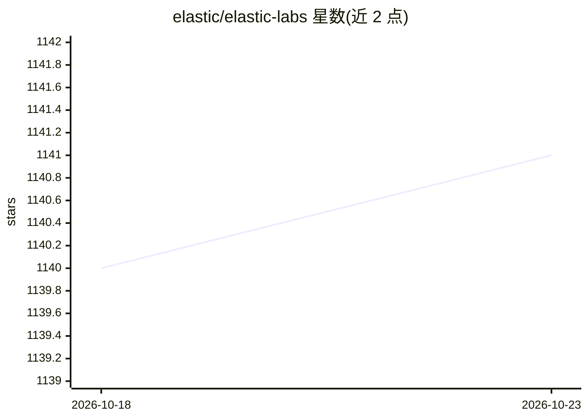

# elastic/elastic-labs

⭐ 1,141 · Jupyter Notebook · Apache-2.0 · 推送 2026-10-15 · [GitHub](https://github.com/elastic/elastic-labs) · 组织维护

**Elastic 平台官方示例库：搜索/可观测/安全的 Notebook 与应用**

由 Elastic 搜索团队维护的可执行 Python Notebook、示例应用与资源集合，覆盖三大场景：搜索（向量数据库、kNN、混合搜索与 RRF、RAG 与聊天机器人、ELSER/E5 语义搜索、语义重排、学习排序）、可观测性（OpenTelemetry 埋点、ES|QL 日志分析、LLM 应用延迟/Token/成本监控）与安全（检测工程、威胁狩猎、提示注入检测）。含 Chatbot RAG 等三个示例应用，Notebook 可在 Colab 中运行，Apache 2.0 许可。

## 筛选速览

| 维度 | 判定 | 备注 |
|---|---|---|
| AI 角色 | `ai-knowledge` | 知识聚合/清单类 |
| 许可风险 | `permissive` | Apache-2.0 |
| 部署形态 | `None` |  |
| 模型依赖 | — | README 未给出锁定关系 |
| 硬件要求 | — | 无带数字的原话,不猜 |
| 安装摩擦 | `low` | 无编译、无系统依赖或容器化 |
| 成熟度 | — | 结构信号不足 |

## 能力要点

- 覆盖搜索/可观测/安全三大场景的可执行 Python Notebook 集合
- 含 Chatbot RAG App、Internal Knowledge Search、Relevance Workbench 三个示例应用
- LLM 应用监控（延迟、Token 用量、成本）与提示注入检测实验
- 展示 Elasticsearch 与 OpenAI、Hugging Face、Cohere、Bedrock、Anthropic、LangChain 的连接方式

## 适用场景

- 学习用 Elasticsearch 构建混合搜索与 RAG 应用
- 参考 OpenTelemetry 接入与 LLM 应用可观测性方案
- 复现安全检测工程与威胁狩猎技术

## 场景标签

`RAG` `语义搜索` `LLM 可观测性` `聊天机器人` · 领域:对话与助手

## 证据(README 行号)

> L3: This repo contains executable Python notebooks, sample apps, and resources for testing out the Elastic platform acro
> L44: The `notebooks` folder contains a range of executable Python notebooks, so you can test these features out for your

## 星数曲线

2026-10-18 1,140 → 2026-10-23 1,141（+1）

---
*卡片 v1 · prompt 1.4 · 生成 2026-10-21 · 置信度 high · 依据 README sha `5c1df5bf6645` · [字段定义](../../DATASET.md)*
