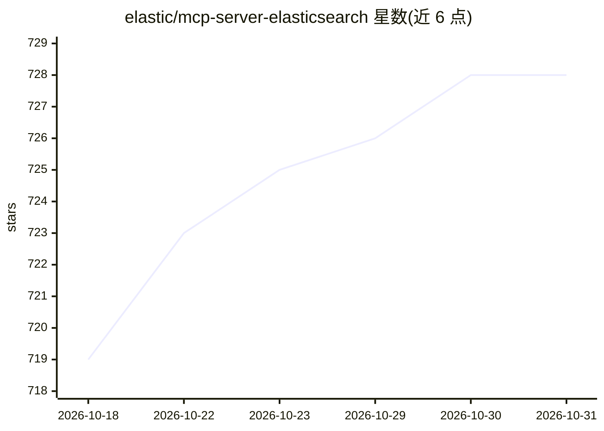

# elastic/mcp-server-elasticsearch

⭐ 728 · Rust · Apache-2.0 · 推送 2026-10-28 · [GitHub](https://github.com/elastic/mcp-server-elasticsearch) · [官网](https://www.elastic.co/elasticsearch) · 组织维护

**连接 AI 代理与 Elasticsearch 数据的 MCP 服务器**

Elastic 官方维护的 Model Context Protocol 服务器，以 Docker 容器形式从 AWS Marketplace 部署，让 Claude Desktop、Cursor、VS Code 等 MCP 客户端通过自然语言查询 Elasticsearch 索引。支持 stdio 与 streamable-HTTP 两种协议（SSE 已弃用），提供 list_indices、get_mappings、search、esql、get_shards 五个工具，通过 API key 或用户名密码认证。README 顶部声明本服务器已弃用，仅接收关键安全更新，由 Elastic 9.2.0+ 的 Agent Builder MCP 端点接替。

## 筛选速览

| 维度 | 判定 | 备注 |
|---|---|---|
| AI 角色 | `ai-ecosystem` | LLM/agent 周边工具 |
| 许可风险 | `permissive` | Apache-2.0 |
| 部署形态 | `self-host` | docker 或自建部署 |
| 模型依赖 | — | README 未给出锁定关系 |
| 硬件要求 | — | 无带数字的原话,不猜 |
| 安装摩擦 | `low` | 无编译、无系统依赖或容器化 |
| 成熟度 | — | 结构信号不足 |

## 能力要点

- 以 Docker 容器镜像从 AWS Marketplace 部署
- 支持 stdio 与 streamable-HTTP 两种协议
- 提供 list_indices/search/esql 等 5 个 Elasticsearch 查询工具
- 支持 API key 与用户名密码认证，凭据仅存于环境变量

## 适用场景

- 让 Claude Desktop 或 Cursor 直接查询我的 Elasticsearch 索引
- 通过自然语言对 Elasticsearch 数据做检索与分析，无需自建 API
- 在 AWS 环境中以容器方式为多个 MCP 客户端提供数据访问

## 场景标签

`数据分析` · 领域:效率与自动化

## 证据(README 行号)

> L9: The Elasticsearch MCP Server connects your AI agents to Elasticsearch data using the Model Context Protocol (MCP).
> L33: The Elasticsearch MCP Server is provided as a Docker container image available from AWS Marketplace. You can run it
> L237: Once connected, the MCP server provides these tools to your agent:

## 星数曲线

2026-10-18 719 → 2026-10-31 728（+9）

---
*卡片 v1 · prompt 1.4 · 生成 2026-10-21 · 置信度 high · 依据 README sha `5f495c410e46` · [字段定义](../../DATASET.md)*
