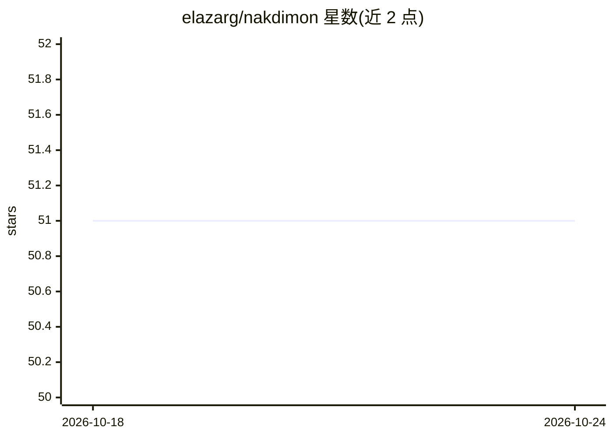

# elazarg/nakdimon

⭐ 51 · Python · MIT · 推送 2026-10-23 · [GitHub](https://github.com/elazarg/nakdimon) · [官网](https://nakdimon.org) · 个人维护

**希伯来文元音符号自动恢复模型（论文配套实现）**

论文 Restoring Hebrew Diacritics Without a Dictionary 的代码仓库：训练序列模型为无元音标注的希伯来文本恢复 niqqud 符号。运行时使用 ONNX Runtime 推理，无需 TensorFlow；模型权重随 wheel 分发。提供 pip 安装与 diacritize CLI、docker 构建、以及训练/评测/消融实验流程（TensorFlow 训练栈为可选 extra）。评测指标含 DEC/CHA/WOR/VOC 及 OOV 指标，可对 Snopi、Dicta 等其他系统跑同一测试集对比。

## 筛选速览

| 维度 | 判定 | 备注 |
|---|---|---|
| AI 角色 | `ai-native` | 本体是模型或模型工具 |
| 许可风险 | `permissive` | MIT |
| 部署形态 | `self-host` | docker 或自建部署 |
| 模型依赖 | — | README 未给出锁定关系 |
| 硬件要求 | — | 无带数字的原话,不猜 |
| 安装摩擦 | `low` | 无编译、无系统依赖或容器化 |
| 成熟度 | — | 结构信号不足 |

## 能力要点

- ONNX Runtime 推理，无需 TensorFlow 即可运行
- 模型权重随 PyPI wheel 打包分发
- 提供训练、ONNX 转换、评测与消融实验的完整流程
- 支持对其他系统（如 Dicta）在同一测试集上评测

## 适用场景

- 为希伯来语文本自动添加元音符号
- 复现论文的训练与评测结果
- 对多个元音化系统做同一测试集的指标对比

## 场景标签

 · 领域:NLP/希伯来语文本处理

## 证据(README 行号)

> L3: Repository for the paper Restoring Hebrew Diacritics Without a Dictionary by Elazar Gershuni and Yuval Pinter.
> L7: Requires Python 3.12+. The runtime uses ONNX Runtime (no TensorFlow required to run inference).

## 星数曲线

2026-10-18 51 → 2026-10-24 51（+0）

---
*卡片 v1 · prompt 1.4 · 生成 2026-10-24 · 置信度 high · 依据 README sha `90fd0c9c1d78` · [字段定义](../../DATASET.md)*
