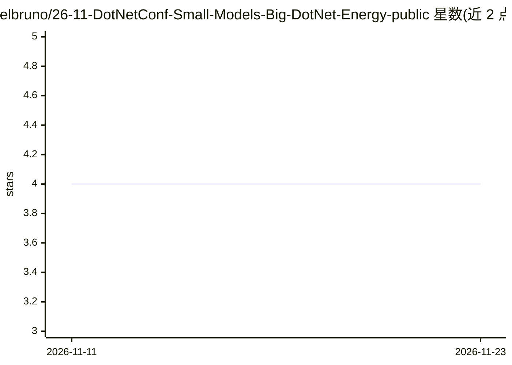

# elbruno/26-11-DotNetConf-Small-Models-Big-DotNet-Energy-public

⭐ 4 · MIT · 推送 2026-11-11 · [GitHub](https://github.com/elbruno/26-11-DotNetConf-Small-Models-Big-DotNet-Energy-public) · [官网](https://dotnet.microsoft.com/en-us/conf/2026/agenda) · 个人维护

**.NET Conf 2026 演示集：用 .NET 本地运行小型 AI 模型**

面向 .NET Conf 2026 演讲观众的示例源码发布，包含 6 个独立的 .NET 演示项目：本地语音转写（Foundry Local）、转录文本清理（ElBruno.S1Mini 库）、经本地 Ollama Decisions 端点的受限决策路由，以及由本地 Decisions 模型控制动作的横版游戏。运行需 Windows x64、global.json 指定的 .NET SDK 11.0.100，并预先缓存对应本地模型权重（仓库不含权重）；Demo 2 麦克风采集未经现场验证，Demo 6 为评审版未完成交互验证。

## 筛选速览

| 维度 | 判定 | 备注 |
|---|---|---|
| AI 角色 | `ai-native` | 本体是模型或模型工具 |
| 许可风险 | `permissive` | MIT |
| 部署形态 | `None` |  |
| 模型依赖 | local-ok | 支持本地模型 |
| 硬件要求 | — | 无带数字的原话,不猜 |
| 安装摩擦 | `medium` | 含编译或系统依赖之一 |
| 成熟度 | — | 结构信号不足 |

## 能力要点

- 6 个独立 .NET 项目，覆盖本地语音转写、文本清理与受限决策路由
- 使用 Foundry Local 与 Ollama 进行本地推理，不静默回退到云服务
- 附幻灯片 PDF 与 PrepareSpeechModel 模型准备工具
- 本地生成合成 WAV 测试音频，仓库不含录音与模型权重

## 适用场景

- 在 .NET 应用中本地运行小型语音转写模型
- 测试本地模型对受限决策请求的响应分布与延迟
- 体验由本地模型控制动作的 C# 游戏仿真

## 场景标签

`语音识别` `推理引擎` · 领域:感知与多模态

## 证据(README 行号)

> L3: This is an audience-facing source release for the .NET Conf 2026 session **Small Models, Big .NET Energy**. The demo
> L9: |`demos/01-foundry-speech-to-text`|Transcribes a generated synthetic WAV locally with Foundry Local.|
> L30: - Demo 5 requires Ollama 0.35.0 or later running locally, with `nimble:latest` installed and its Decisions capabili

## 星数曲线

2026-11-11 4 → 2026-11-23 4（+0）

---
*卡片 v1 · prompt 1.4 · 生成 2026-11-21 · 置信度 high · 依据 README sha `2d67adc7a285` · [字段定义](../../DATASET.md)*
