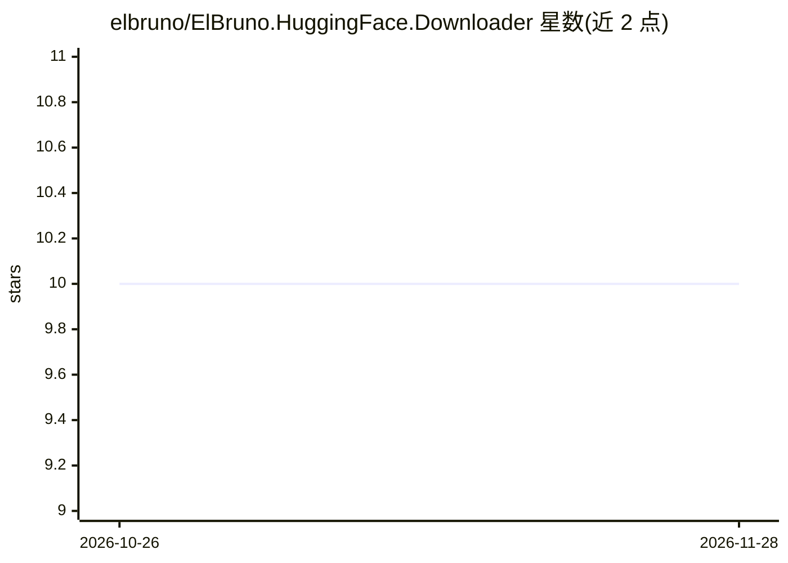

# elbruno/ElBruno.HuggingFace.Downloader

⭐ 10 · C# · MIT · 推送 2026-11-18 · [GitHub](https://github.com/elbruno/ElBruno.HuggingFace.Downloader) · [官网](https://elbruno.github.io/ElBruno.HuggingFace.Downloader/) · 个人维护

**供 .NET 开发者从 Hugging Face 下载模型与分词器文件的库与 CLI**

提供 .NET 库（NuGet）与 CLI 工具（hfdownload）两类形态，用于从 Hugging Face Hub 仓库下载 ONNX 模型、分词器、语音预设等文件。机制包括：进度分阶段上报（检查/下载/校验）、临时文件原子写入、HTTP range 断点续传、revision 钉定与提交 SHA 校验、仓库文件枚举、基于 manifest 的捆绑下载与 SHA-256/大小校验、HF_TOKEN 认证访问 gated/私有仓库、自定义 Hub endpoint、跨平台缓存目录与 DI/ILogger 集成。库面向 .NET 8/10/11 与 netstandard2.0，源码构建需 .NET 8 SDK。

## 筛选速览

| 维度 | 判定 | 备注 |
|---|---|---|
| AI 角色 | `ai-ecosystem` | LLM/agent 周边工具 |
| 许可风险 | `permissive` | MIT |
| 部署形态 | `None` |  |
| 模型依赖 | — | README 未给出锁定关系 |
| 硬件要求 | — | 无带数字的原话,不猜 |
| 安装摩擦 | `medium` | 含编译或系统依赖之一 |
| 成熟度 | — | 结构信号不足 |

## 能力要点

- 断点续传、原子写入与已存在文件跳过
- manifest 捆绑下载含 SHA-256 与大小校验
- HF_TOKEN 认证与自定义 HF_ENDPOINT 私有端点
- 跨平台缓存目录与 IServiceCollection/ILogger 集成

## 适用场景

- 在 .NET 应用启动前自动拉取所需 ONNX 模型文件
- 下载 gated/私有 Hugging Face 仓库中的文件
- 以 manifest 方式批量下载并校验模型文件集完整性

## 场景标签

 · 领域:AI 生态/开发工具

## 证据(README 行号)

> L10: A .NET library and CLI tool to download files (ONNX models, tokenizers, voice presets, etc.) from Hugging Face Hub 
> L39: The library targets .NET 8, .NET 10, .NET 11, and .NET Standard 2.0. The CLI tool targets .NET 8, .NET 10, and .NET
> L37: |ElBruno.HuggingFace.Downloader.Cli|NuGet|Downloads|CLI tool (`hfdownload`) for managing Hugging Face downloads|

## 星数曲线

2026-10-26 10 → 2026-11-28 10（+0）

---
*卡片 v1 · prompt 1.4 · 生成 2026-11-19 · 置信度 high · 依据 README sha `7916df605155` · [字段定义](../../DATASET.md)*
