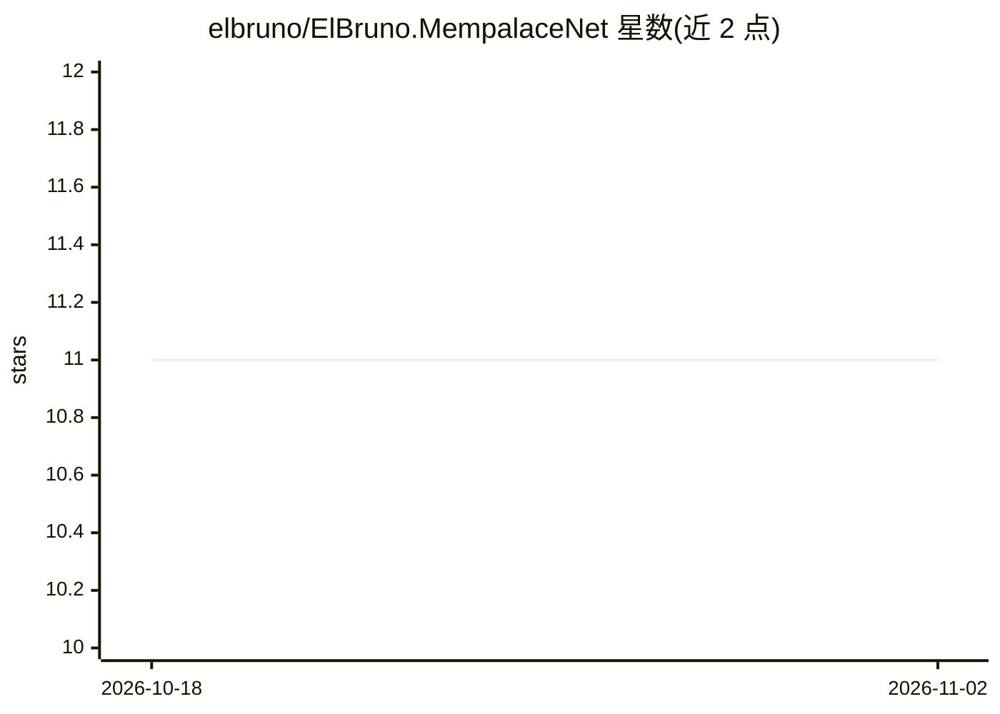

# elbruno/ElBruno.MempalaceNet

⭐ 11 · C# · MIT · 推送 2026-07-01 · [GitHub](https://github.com/elbruno/ElBruno.MempalaceNet) · 个人维护

**.NET 本地优先 AI 记忆库：原文存储+语义搜索+知识图谱**

MemPalace 的 .NET 移植版，提供本地优先的 AI 记忆层：以 wings/rooms/drawers 层级组织知识，原文存储，SQLite 后端以 BLOB 向量与余弦相似度实现语义/关键词/混合搜索。默认通过 ONNX 本地嵌入（ElBruno.LocalEmbeddings），无 API key 与云端调用；基于 Microsoft.Extensions.AI 可切换 Ollama/OpenAI/Azure。另含时序知识图谱、文件与会话转录摄入、MCP 服务器（7 个工具）与 Microsoft Agent Framework 集成，以 NuGet 包套件分发，可按需安装。

## 筛选速览

| 维度 | 判定 | 备注 |
|---|---|---|
| AI 角色 | `ai-ecosystem` | LLM/agent 周边工具 |
| 许可风险 | `permissive` | MIT |
| 部署形态 | `None` |  |
| 模型依赖 | local-ok | 支持本地模型 |
| 硬件要求 | — | 无带数字的原话,不猜 |
| 安装摩擦 | `medium` | 含编译或系统依赖之一 |
| 成熟度 | — | 结构信号不足 |

## 能力要点

- 本地 ONNX 嵌入，默认无云端调用与 API key
- SQLite BLOB 向量 + 余弦相似度，语义/关键词/混合搜索与重排
- 时序实体关系知识图谱（validity windows）
- MCP 服务器（7 个工具）与 Microsoft Agent Framework 集成

## 适用场景

- 为 .NET 应用或 agent 提供可本地运行的长期记忆
- 把文件和会话转录摄入为可语义检索的知识库
- 通过 MCP 向 Claude Desktop、VS Code 暴露记忆工具

## 场景标签

`Agent 记忆` `知识图谱` `语义搜索` · 领域:Agent 开发

## 证据(README 行号)

> L8: A **.NET port** of MemPalace — local-first AI memory that stores everything verbatim, searches semantically, and org
> L31: - **Local-first by default** — ONNX embeddings via ElBruno.LocalEmbeddings (no API keys, no cloud calls)
> L32: - **Microsoft.Extensions.AI** — swap embedders and LLMs with zero lock-in

## 星数曲线

2026-10-18 11 → 2026-11-02 11（+0）

---
*卡片 v1 · prompt 1.4 · 生成 2026-11-02 · 置信度 high · 依据 README sha `300e18f26e41` · [字段定义](../../DATASET.md)*
