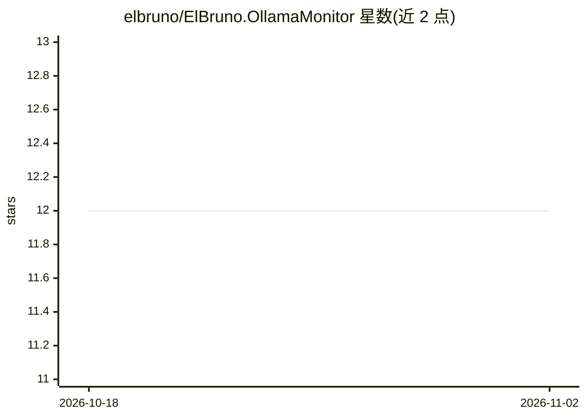

# elbruno/ElBruno.OllamaMonitor

⭐ 12 · C# · MIT · 推送 2026-07-02 · [GitHub](https://github.com/elbruno/ElBruno.OllamaMonitor) · [官网](https://elbruno.github.io/ElBruno.OllamaMonitor/) · 个人维护

**Windows 托盘工具：监控本地 Ollama 运行状态与资源占用**

基于 .NET/WPF 的 Windows 系统托盘应用，面向本地运行 Ollama 的开发者：通过托盘图标颜色显示 Ollama 是否可达、模型是否加载，实时读取 Ollama 进程的 CPU/RAM/GPU 占用，并支持停止、拉取、删除、复制模型等管理操作。提供常驻的半透明迷你监视窗口、可配置的端点/刷新率/阈值及 CLI 脚本化配置。要求 Windows 10/11 与 .NET 10 运行时，本地需运行 Ollama；NVIDIA GPU 指标依赖 nvidia-smi（可选）。经 NuGet 以 dotnet tool 安装。

## 筛选速览

| 维度 | 判定 | 备注 |
|---|---|---|
| AI 角色 | `ai-ecosystem` | LLM/agent 周边工具 |
| 许可风险 | `permissive` | MIT |
| 部署形态 | `None` |  |
| 模型依赖 | local-ok | 支持本地模型 |
| 硬件要求 | — | 无带数字的原话,不猜 |
| 安装摩擦 | `medium` | 含编译或系统依赖之一 |
| 成熟度 | — | 结构信号不足 |

## 能力要点

- 托盘图标颜色编码显示 Ollama 运行/模型加载/错误状态
- 实时读取 Ollama 进程的 CPU/RAM/GPU 资源指标
- 模型管理：停止、拉取、删除、复制模型标签
- 半透明置顶迷你监视窗口与 CLI 脚本化配置

## 适用场景

- 本地跑大模型时随时查看 Ollama 的资源开销
- 演示或开发时快速确认 Ollama 与模型加载状态
- 不打开浏览器即可执行 ollama 模型管理操作

## 场景标签

 · 领域:本地 AI 运行时监控工具

## 证据(README 行号)

> L9: A tiny Windows system tray tool to monitor your local Ollama runtime.
> L21: - **How much CPU, RAM, and GPU is it using?** Real-time resource metrics from the Ollama process.
> L26: - Local AI developers who need quick visibility into Ollama

## 星数曲线

2026-10-18 12 → 2026-11-02 12（+0）

---
*卡片 v1 · prompt 1.4 · 生成 2026-11-01 · 置信度 high · 依据 README sha `858a2017777f` · [字段定义](../../DATASET.md)*
