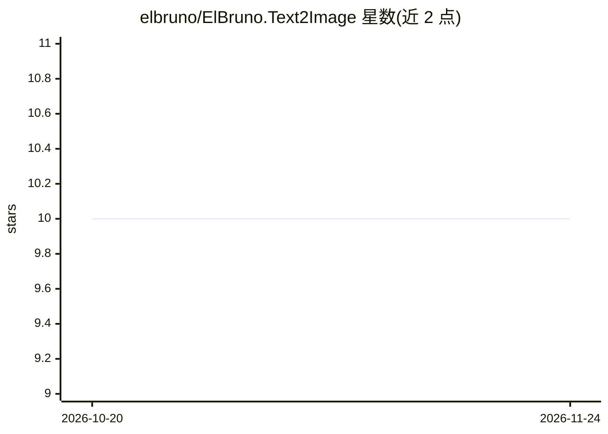

# elbruno/ElBruno.Text2Image

⭐ 10 · C# · MIT · 推送 2026-11-18 · [GitHub](https://github.com/elbruno/ElBruno.Text2Image) · 个人维护

**.NET 开发者的文生图库：本地 ONNX 与云 API 统一接口**

面向 .NET 开发者的文本生成图像库，提供 NuGet 包、全局 CLI 工具与 agent skill 三种使用方式。本地路径基于 ONNX Runtime 运行 Stable Diffusion 系列模型（模型从 HuggingFace 自动下载），云路径封装 Microsoft Foundry 与 Azure OpenAI 的 FLUX.2、MAI-Image、GPT-Image 系列 API；所有生成器实现 Microsoft.Extensions.AI 的 IImageGenerator 接口，GPU 按 CUDA→DirectML→CPU 自动回退，无需 Python 环境。硬件包（Cpu/Cuda/DirectML）互斥安装。

## 筛选速览

| 维度 | 判定 | 备注 |
|---|---|---|
| AI 角色 | `ai-native` | 本体是模型或模型工具 |
| 许可风险 | `permissive` | MIT |
| 部署形态 | `None` |  |
| 模型依赖 | locked-api |  |
| 硬件要求 | `cpu-ok` | |
| 安装摩擦 | `medium` | 含编译或系统依赖之一 |
| 成熟度 | — | 结构信号不足 |

## 能力要点

- 本地 ONNX（Stable Diffusion 1.5/2.1、SDXL Turbo、LCM Dreamshaper）与云 API 统一 .NET 接口
- 自动 GPU 检测，CUDA→DirectML→CPU 回退，跨 Windows/Linux/macOS
- 所有生成器实现 Microsoft.Extensions.AI IImageGenerator，支持依赖注入
- t2i CLI 含 GitHub Copilot 与 Claude Code 的 agent skill（t2i init 安装）

## 适用场景

- 在 .NET 应用中离线生成图像而不引入 Python 环境
- 同一套代码在本地 Stable Diffusion 与云 FLUX/GPT-Image 之间切换
- 让 Copilot/Claude Code 通过 skill 调用 t2i 生成图像

## 场景标签

`图像生成` · 领域:内容生成

## 证据(README 行号)

> L32: **Text-to-image for .NET developers: use as library, CLI tool, or AI coding skill. Cloud (FLUX.2, MAI-Image-2.5/2.6
> L72: ✅ **Auto GPU detection** — CUDA → DirectML → CPU fallback
> L143: - 🔌 **Microsoft.Extensions.AI** — All generators implement `IImageGenerator` from Microsoft.Extensions.AI

## 星数曲线

2026-10-20 10 → 2026-11-24 10（+0）

---
*卡片 v1 · prompt 1.4 · 生成 2026-11-19 · 置信度 high · 依据 README sha `acc77a9a2602` · [字段定义](../../DATASET.md)*
