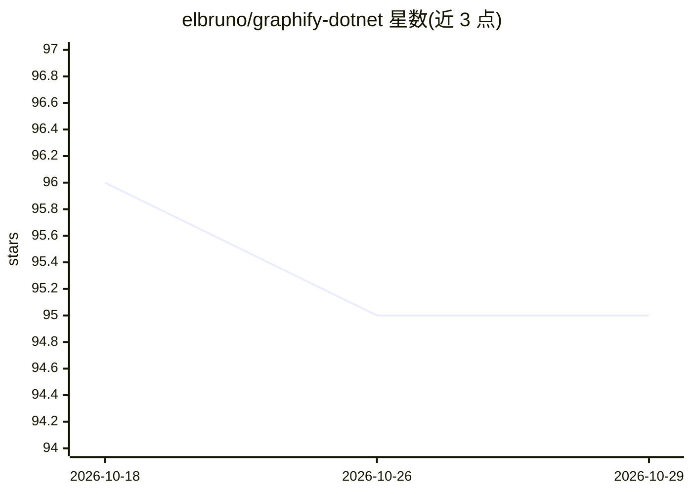

# elbruno/graphify-dotnet

⭐ 95 · C# · MIT · 推送 2026-07-01 · [GitHub](https://github.com/elbruno/graphify-dotnet) · 个人维护

**为开发者从代码库构建 AI 知识图谱的 .NET 工具**

graphify 的 .NET 10 移植版，以 .NET 全局工具（dotnet tool）形式分发：读取代码、配置、文档与图片文件，通过 AST 解析提取类、函数、导入等结构，可选接入 Azure OpenAI、Ollama 或 Copilot SDK 做语义概念与关系提取，构建带社区检测的知识图谱，并导出 HTML 交互图、JSON、SVG、Neo4j Cypher、Obsidian Vault 等多种格式。支持 18 种代码语言与多种文档/媒体类型。AI 提供方完全可选，无 AI 时仍可零配置产出纯结构图。面向希望按结构而非关键词导航代码库的开发者。

## 筛选速览

| 维度 | 判定 | 备注 |
|---|---|---|
| AI 角色 | `ai-enhanced` | 去掉 AI 部分产品仍成立 |
| 许可风险 | `permissive` | MIT |
| 部署形态 | `None` |  |
| 模型依赖 | local-ok | 支持本地模型 |
| 硬件要求 | — | 无带数字的原话,不猜 |
| 安装摩擦 | `medium` | 含编译或系统依赖之一 |
| 成熟度 | — | 结构信号不足 |

## 能力要点

- AST 解析 + 可选 AI 语义分析构建代码知识图谱，含社区检测
- 18 种代码语言及配置/文档/媒体文件类型支持
- 零配置的 AST-only 模式，无 AI 提供方也可产出结构图
- HTML 交互图、JSON、SVG、Neo4j Cypher、Obsidian Vault 等多种导出格式

## 适用场景

- 接手陌生代码库时按结构与关系而非关键词导航
- 为知识库或 Obsidian Vault 生成代码库的概念图谱
- 导出 Neo4j Cypher 用于图数据库中的代码结构分析

## 场景标签

`知识图谱` · 领域:知识与检索

## 证据(README 行号)

> L12: graphify-dotnet reads your files (code, docs, images), extracts concepts and relationships through AST parsing and 
> L57: **No AI provider? No problem.** AST-only extraction works with zero config and produces structural graphs from code

## 星数曲线

2026-10-18 96 → 2026-10-29 95（-1）

---
*卡片 v1 · prompt 1.4 · 生成 2026-10-23 · 置信度 high · 依据 README sha `2aea2f336494` · [字段定义](../../DATASET.md)*
