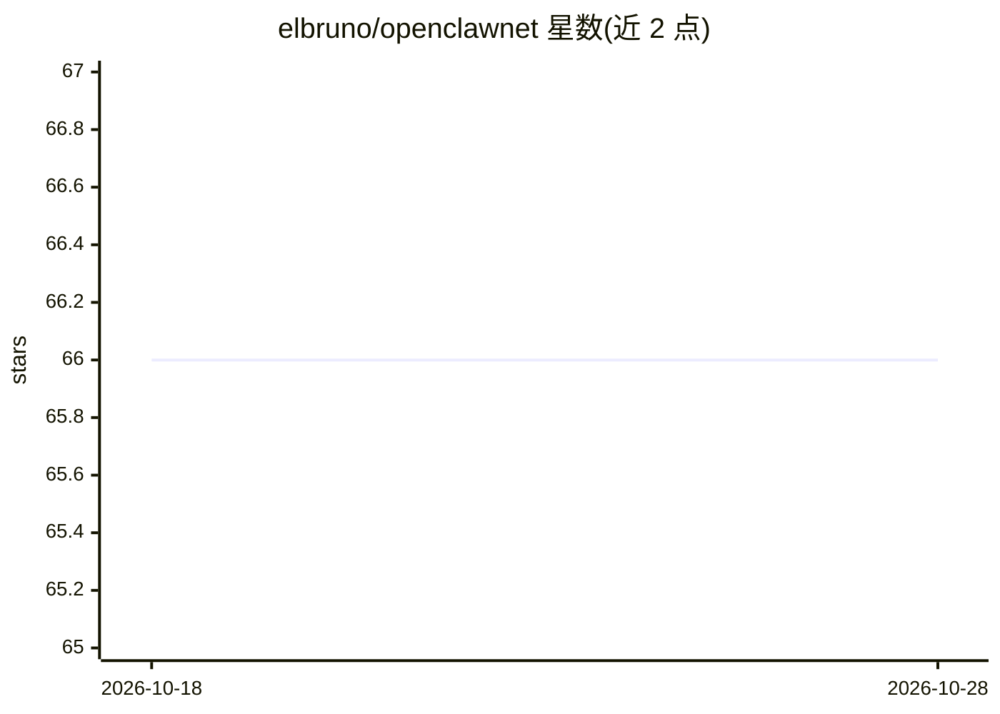

# elbruno/openclawnet

⭐ 66 · C# · MIT · 推送 2026-09-28 · [GitHub](https://github.com/elbruno/openclawnet) · 个人维护

**用 .NET 10 构建 AI Agent 平台的系列课程配套仓库**

Microsoft Reactor 直播系列（4 场，每场 50 分钟）的配套仓库，主题为用 .NET 10、Aspire、Blazor 与 GitHub Copilot 构建生产级 AI Agent 平台。仓库包含完整应用源码（40+ 项目：Gateway、Web、Agent、Memory、Skills、模型提供方、工具、MCP 服务器）、单元/集成/Playwright 测试、手册、演示脚本与每场听众材料。仅以源码形式发布，不发布 NuGet 包，通过 git clone 本地构建运行，架构从聊天路径逐场扩展到完整 Agent 平台。

## 筛选速览

| 维度 | 判定 | 备注 |
|---|---|---|
| AI 角色 | `ai-knowledge` | 知识聚合/清单类 |
| 许可风险 | `permissive` | MIT |
| 部署形态 | `None` |  |
| 模型依赖 | — | README 未给出锁定关系 |
| 硬件要求 | — | 无带数字的原话,不猜 |
| 安装摩擦 | `medium` | 含编译或系统依赖之一 |
| 成熟度 | — | 结构信号不足 |

## 能力要点

- 40+ 项目的 .NET 10 + Aspire 完整应用源码（Gateway/Agent/Memory/Skills/MCP 等）
- 4 场系列课程材料：基础聊天→工具→技能与记忆→自动化与云
- 支持本地与云共 4 类模型提供方，SignalR 流式输出
- 单元、集成与 Playwright E2E 测试套件

## 适用场景

- 跟着 Reactor 系列直播学习构建 AI Agent 平台
- 在本机从源码重建并扩展一个 .NET Agent 平台
- 参考其架构分析与设计文档做自己的 Agent 项目

## 场景标签

`教程课程` `Agent 框架` · 领域:Agent 开发

## 证据(README 行号)

> L5: OpenClaw .NET is the companion repo for the **Microsoft Reactor live series** on building production‑ready AI agents
> L61: - **`sessions/`** — per‑session attendee materials (READMEs, scripts, slides, demo code).

## 星数曲线

2026-10-18 66 → 2026-10-28 66（+0）

---
*卡片 v1 · prompt 1.4 · 生成 2026-10-24 · 置信度 high · 依据 README sha `3f66508c7d22` · [字段定义](../../DATASET.md)*
