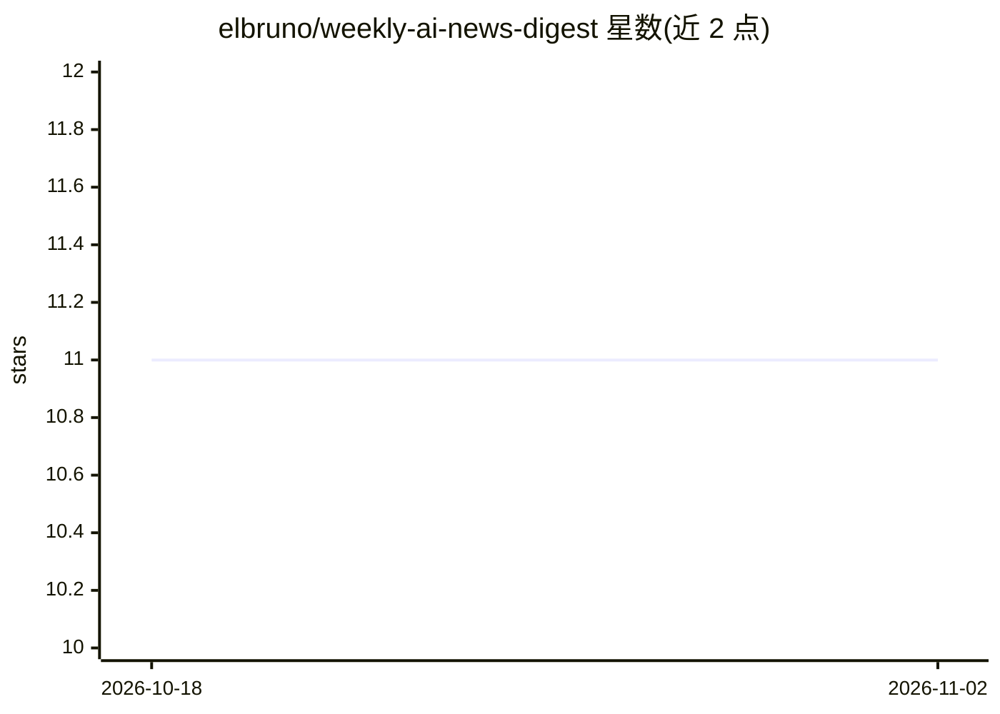

# elbruno/weekly-ai-news-digest

⭐ 11 · Python · MIT · 推送 2026-10-31 · [GitHub](https://github.com/elbruno/weekly-ai-news-digest) · [官网](https://elbruno.github.io/weekly-ai-news-digest) · 个人维护

**用 GitHub Agentic Workflows 每日自动生成的 AI 新闻摘要站**

由传统 GitHub Actions 协调器抓取 8 个 RSS 源（GitHub Changelog、Microsoft Developer、TechCrunch AI、MIT Tech Review、Hacker News 等），规范化、去重并冻结为不可变快照，再交给控制模型（暂为 gpt-5.4，替代 Claude Sonnet）与 GPT-5 Mini 两个 agent 生成配对摘要，用于测量小模型在降低 AI Credit 消耗下能否保持摘要质量。发布由确定性流水线完成，附带 AI Credit 账本、用量与配对对比面板，站点部署于 GitHub Pages，工作日 6:00（多伦多时间）自动运行。读者可在生成的摘要页上筛选、排序与全文搜索，另有面向浏览器 agent 的 WebMCP 工具。

## 筛选速览

| 维度 | 判定 | 备注 |
|---|---|---|
| AI 角色 | `ai-native` | 本体是模型或模型工具 |
| 许可风险 | `permissive` | MIT |
| 部署形态 | `None` |  |
| 模型依赖 | — | README 未给出锁定关系 |
| 硬件要求 | — | 无带数字的原话,不猜 |
| 安装摩擦 | `low` | 无编译、无系统依赖或容器化 |
| 成熟度 | — | 结构信号不足 |

## 能力要点

- 同一不可变 RSS 快照喂给控制模型与 GPT-5 Mini 的配对实验设计
- 确定性发布器串行化合并、AI Credit 对账与 GitHub Pages 部署
- 无 AI 的用量面板与按快照 ID 配对的成本/发布对比面板
- 摘要页提供筛选、排序、全文搜索与面向浏览器 agent 的 WebMCP 工具

## 适用场景

- 每天浏览 AI 与开发者平台新闻的筛选摘要
- 比较大小模型在相同输入下的生成成本与产出
- 参考其单文件 agentic workflow 示例学习 GitHub Agentic Workflows

## 场景标签

`AI 写作` `教程课程` · 领域:内容生成

## 证据(README 行号)

> L5: > **Daily agentic digest of the best AI and technology news, generated with GitHub Agentic Workflows.**
> L20: This repository runs a controlled model experiment, not two unrelated news jobs. A traditional GitHub Actions coord
> L58: - A GitHub and Microsoft Developer-priority selection of AI and developer-platform news.

## 星数曲线

2026-10-18 11 → 2026-11-02 11（+0）

---
*卡片 v1 · prompt 1.4 · 生成 2026-11-02 · 置信度 mid · 依据 README sha `9c5a815b5f06` · [字段定义](../../DATASET.md)*
