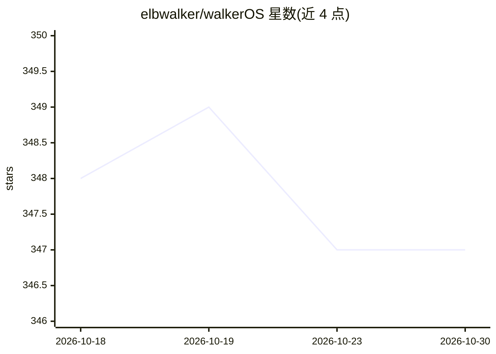

# elbwalker/walkerOS

⭐ 347 · TypeScript · MIT · 推送 2026-10-29 · [GitHub](https://github.com/elbwalker/walkerOS) · [官网](https://www.walkeros.io/) · 组织维护

**面向开发者的开源事件采集/标签管理器，经 MCP 供 AI agent 使用**

自托管的事件采集层：以 Config-as-code 方式用版本控制管理埋点，声明式 HTML 标签、采集时 schema 校验、consent 队列与多目的地路由，事件可送入 BigQuery 等数据仓库及 GA4、Meta CAPI、Google Ads 等广告平台。提供两种安装模式：TypeScript 应用内集成或从 JSON 配置用 npx walkeros 构建独立脚本。另暴露 MCP 接口，AI agent 可读取事件 schema、建议埋点定义并生成集成代码，本地运行无需账号。

## 筛选速览

| 维度 | 判定 | 备注 |
|---|---|---|
| AI 角色 | `ai-enhanced` | 去掉 AI 部分产品仍成立 |
| 许可风险 | `permissive` | MIT |
| 部署形态 | `library` | 以包/库形式分发 |
| 模型依赖 | — | README 未给出锁定关系 |
| 硬件要求 | — | 无带数字的原话,不猜 |
| 安装摩擦 | `low` | 无编译、无系统依赖或容器化 |
| 成熟度 | — | 结构信号不足 |

## 能力要点

- Config-as-code 埋点配置，可走 PR 审查与版本控制
- 单一事件定义路由到数据仓库与多个广告平台目的地
- consent 队列与采集时 schema 校验
- MCP 接口让 AI agent 读取 schema、建议埋点、生成集成代码

## 适用场景

- 统一管理网站/应用埋点，替代分散的标签与像素配置
- 将事件干净地落入自有数据仓库供分析
- 让 AI agent 通过 MCP 参与埋点定义与集成代码生成

## 场景标签

 · 领域:数据分析/标签管理

## 证据(README 行号)

> L23: From browser to BigQuery and ad platforms - warehouse-native, and ready for AI
> L108: walkerOS exposes a Model Context Protocol (MCP) interface. AI agents can read

## 星数曲线

2026-10-18 348 → 2026-10-30 347（-1）

---
*卡片 v1 · prompt 1.4 · 生成 2026-10-22 · 置信度 high · 依据 README sha `ddfcbf554f5f` · [字段定义](../../DATASET.md)*
