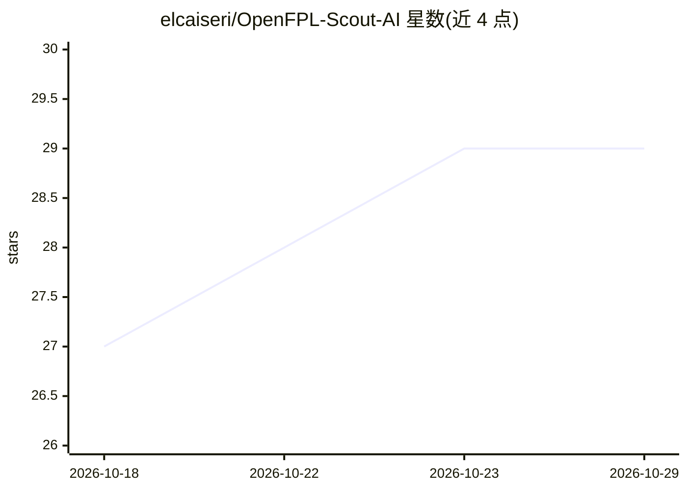

# elcaiseri/OpenFPL-Scout-AI

⭐ 29 · Python · MIT · 推送 2026-10-28 · [GitHub](https://github.com/elcaiseri/OpenFPL-Scout-AI) · [官网](https://openfpl.kassem.dev) · 个人维护

**FPL（英超梦幻联赛）球员积分预测与阵容选择应用**

读取官方 FPL 数据（球员、俱乐部、赛程、可用性、积分榜等），用 Ridge、XGBoost、CatBoost 与 MLP 四模型集成预测每名球员的 Gameweek 积分，并按官方位置配额与每俱乐部最多三人的规则选出 15 人阵容、指定正副队长；支持对公开 FPL 队伍按同一基准打 0–100 评分。以 FastAPI 服务加响应式 Web 仪表盘交付，含冻结预测存档与可选 FPL Data 数据补全。选阵有意不含预算约束，价格仅作参考。本地运行需 Python 3.9+ 与 uv，且模型产物不随 Git 分发。

## 筛选速览

| 维度 | 判定 | 备注 |
|---|---|---|
| AI 角色 | `ai-native` | 本体是模型或模型工具 |
| 许可风险 | `permissive` | MIT |
| 部署形态 | `self-host` | docker 或自建部署 |
| 模型依赖 | — | README 未给出锁定关系 |
| 硬件要求 | — | 无带数字的原话,不猜 |
| 安装摩擦 | `low` | 无编译、无系统依赖或容器化 |
| 成熟度 | — | 结构信号不足 |

## 能力要点

- Ridge/XGBoost/CatBoost/MLP 四模型集成预测球员积分
- 按官方位置配额与每俱乐部≤3人规则选 15 人阵容并指定正副队长
- 截止日后返回冻结的赛前预测（frozen forecast），不再随新信息改变
- 对公开 FPL 队伍 ID 输出 0–100 阵容评分（首发/队长/可用性分项）

## 适用场景

- 每轮 FPL 截止前获取球员积分预测与完整阵容推荐
- 把自己的 FPL 队伍与 AI 基准对比评分
- 通过 API 查询球员预测、赛程难度与经理/联赛数据

## 场景标签

 · 领域:体育/预测分析

## 证据(README 行号)

> L5: OpenFPL predicts Fantasy Premier League player points and selects a complete
> L7: Ridge, XGBoost, CatBoost, and MLP ensemble, then presents the result through a
> L8: responsive web dashboard and FastAPI service.

## 星数曲线

2026-10-18 27 → 2026-10-29 29（+2）

---
*卡片 v1 · prompt 1.4 · 生成 2026-10-26 · 置信度 high · 依据 README sha `866c6c350488` · [字段定义](../../DATASET.md)*
