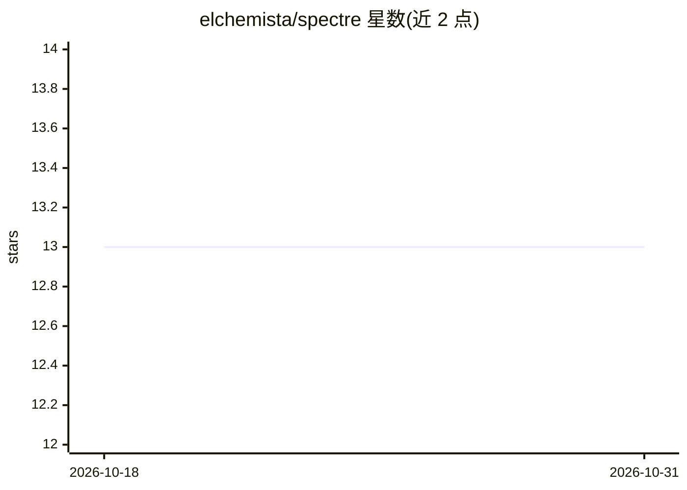

# elchemista/spectre

⭐ 13 · Elixir · Apache-2.0 · 推送 2026-09-09 · [GitHub](https://github.com/elchemista/spectre) · [官网](https://spectre.guide) · 个人维护

**Elixir 的 OTP 原生 agent 构建运行时框架**

基于 Elixir/OTP 的 agent 运行时库，把 agent 建模为监督进程集合：路由、状态、策略与副作用显式化。模型只能提议工作，受保护动作需经确定性策略门控并经宿主显式调用才执行；路由按配置从纯 regex 到 llm_classifier 分级可选。agent 编译为内容寻址的 Definition，变更经治理流程（评审/批准/回滚）；另有 9 个可选生态包（记忆、A2A 通信、浏览器感知等）独立版本化。以 Hex 包安装，0.x 阶段 API 可能变动。

## 筛选速览

| 维度 | 判定 | 备注 |
|---|---|---|
| AI 角色 | `ai-ecosystem` | LLM/agent 周边工具 |
| 许可风险 | `permissive` | Apache-2.0 |
| 部署形态 | `None` |  |
| 模型依赖 | — | README 未给出锁定关系 |
| 硬件要求 | — | 无带数字的原话,不猜 |
| 安装摩擦 | `low` | 无编译、无系统依赖或容器化 |
| 成熟度 | `idea` | |

## 能力要点

- 模型仅提议不执行：副作用经确定性策略门控与显式宿主调用
- 路由可配置确定性程度（regex/embedding/classifier/llm_classifier）
- 内容寻址 Definition 与变更治理（评审、批准、激活、回滚）
- 9 个独立版本化的可选生态扩展包

## 适用场景

- 在 Elixir/OTP 应用中构建受控的 LLM agent
- 需要审批门控与可回滚 agent 变更的生产环境
- 为 agent 增加记忆、多 agent 通信或浏览器操作等扩展

## 场景标签

`Agent 框架` · 领域:Agent 开发

## 证据(README 行号)

> L7: **An OTP-native Elixir runtime for building agents whose routing, state,
> L10: Spectre treats an agent the way OTP treats a system: a supervised set of
> L154: Spectre core stays focused on Agent definitions, routing, policy, state,

## 星数曲线

2026-10-18 13 → 2026-10-31 13（+0）

---
*卡片 v1 · prompt 1.4 · 生成 2026-10-31 · 置信度 high · 依据 README sha `1b759056a93a` · [字段定义](../../DATASET.md)*
