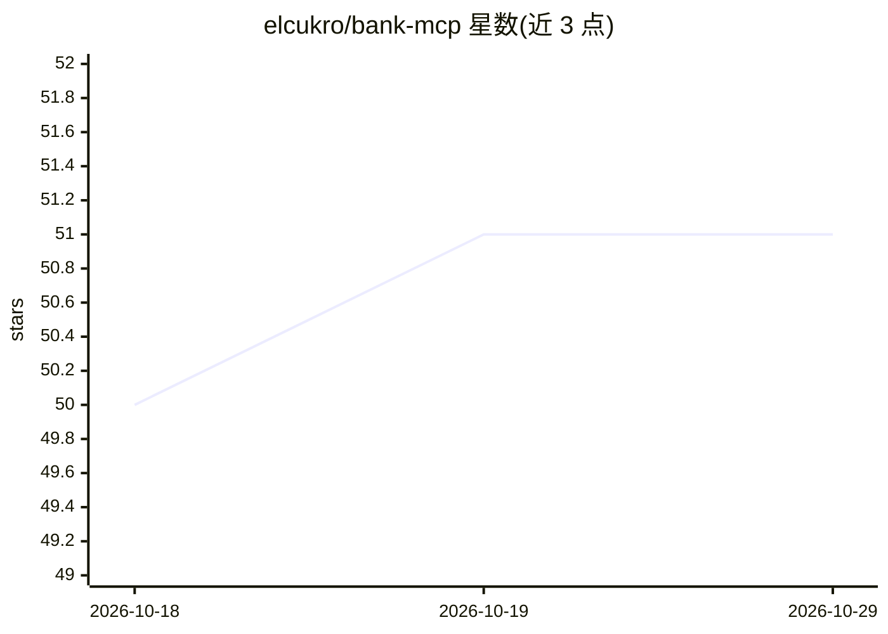

# elcukro/bank-mcp

⭐ 51 · TypeScript · MIT · 推送 2026-05-23 · [GitHub](https://github.com/elcukro/bank-mcp) · 个人维护

**让 AI 助手安全只读访问银行账户的 MCP 服务器**

基于 Model Context Protocol 的 stdio 服务器，通过 Plaid、Teller、Enable Banking、Tink 等开放银行 API 连接 15,000+ 家美欧银行机构，向 MCP 客户端（Claude Code、Claude Desktop、Cursor、VS Code 等）提供 5 个只读工具：账户列表、交易查询与全文搜索、余额、消费汇总。设计上仅暴露读方法（类型层面禁止转账），凭据以 600 权限存于本地，进程内缓存余额 5 分钟/交易 15 分钟/账户 1 小时。提供 npx 交互式安装向导与 Mock 假数据演示模式，支持多连接跨行合并查询，新增 provider 约 100 行内实现。

## 筛选速览

| 维度 | 判定 | 备注 |
|---|---|---|
| AI 角色 | `ai-ecosystem` | LLM/agent 周边工具 |
| 许可风险 | `permissive` | MIT |
| 部署形态 | `library` | 以包/库形式分发 |
| 模型依赖 | locked-api |  |
| 硬件要求 | — | 无带数字的原话,不猜 |
| 安装摩擦 | `low` | 无编译、无系统依赖或容器化 |
| 成熟度 | — | 结构信号不足 |

## 能力要点

- 5 个银行 provider 接入（Plaid/Teller/Enable Banking/Tink/Mock）
- 接口层强制只读：无转账、无写入方法，stdio 进程无网络监听
- npx 交互式安装向导覆盖凭证、银行授权与账户验证
- 多连接配置，工具可跨 provider 合并查询

## 适用场景

- 用自然语言向 AI 助手查询余额、交易与分类消费
- 跨多家银行汇总个人财务数据
- 在接入真实银行前用 Mock 模式测试与开发

## 场景标签

 · 领域:金融科技/LLM 工具接入

## 证据(README 行号)

> L13: Most people manage their finances by logging into bank portals, downloading CSVs, and building spreadsheets. bank-m
> L201: > **Don't see your tool?** bank-mcp uses standard MCP stdio transport. Any client that supports MCP stdio servers 
> L393: Your Bank's API ← HTTPS → bank-mcp (local process) ← stdio → MCP Client (local)

## 星数曲线

2026-10-18 50 → 2026-10-29 51（+1）

---
*卡片 v1 · prompt 1.4 · 生成 2026-10-24 · 置信度 high · 依据 README sha `91be20ec1929` · [字段定义](../../DATASET.md)*
