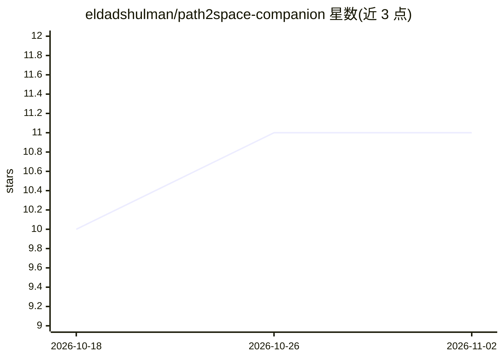

# eldadshulman/path2space-companion

⭐ 11 · Python · Apache-2.0 · 推送 2026-05-14 · [GitHub](https://github.com/eldadshulman/path2space-companion) · [官网](https://doi.org/10.1016/j.cell.2026.04.023) · 个人维护

**从 H&E 病理切片预测空间转录组的论文配套代码**

Shulman et al., Cell 2026 论文的配套代码库，由相互独立的组件构成，每个组件有独立 README、setup.py 与测试。当前包含 ge_model 组件：用 CTransPath 特征提取器加 22×7 MLP 集成，从 H&E 组织病理切片预测点位级空间转录组（约 1.4 万基因）。训练好的模型权重、HEST 演示数据与代码快照均通过 Zenodo DOI 归档，演示 notebook 首次运行时自动拉取演示数据；后续将新增去卷积、聚类身份等组件。面向计算病理学与生物信息学研究者。

## 筛选速览

| 维度 | 判定 | 备注 |
|---|---|---|
| AI 角色 | `ai-native` | 本体是模型或模型工具 |
| 许可风险 | `permissive` | Apache-2.0 |
| 部署形态 | `None` |  |
| 模型依赖 | — | README 未给出锁定关系 |
| 硬件要求 | — | 无带数字的原话,不猜 |
| 安装摩擦 | `low` | 无编译、无系统依赖或容器化 |
| 成熟度 | — | 结构信号不足 |

## 能力要点

- 从 H&E 切片预测约 14K 基因的点位级空间转录组
- CTransPath 特征提取器 + 22×7 MLP 集成
- 模型权重与演示数据经 Zenodo DOI 归档，权重可自动获取
- 组件化结构，各组件可独立安装使用

## 适用场景

- 在新病理切片上运行基因表达预测推理
- 复现 Cell 2026 论文方法
- 在 HEST 演示数据上试用模型 notebook

## 场景标签

 · 领域:生物信息学/计算病理学

## 证据(README 行号)

> L23: |`ge_model/`|Path2Space gene-expression prediction model. Predicts spot-level spatial transcriptomics (≈14 K genes)
> L9: > **AI-predicted spatial transcriptomics unlocks breast cancer biomarkers from

## 星数曲线

2026-10-18 10 → 2026-11-02 11（+1）

---
*卡片 v1 · prompt 1.4 · 生成 2026-11-02 · 置信度 high · 依据 README sha `5976da71a222` · [字段定义](../../DATASET.md)*
