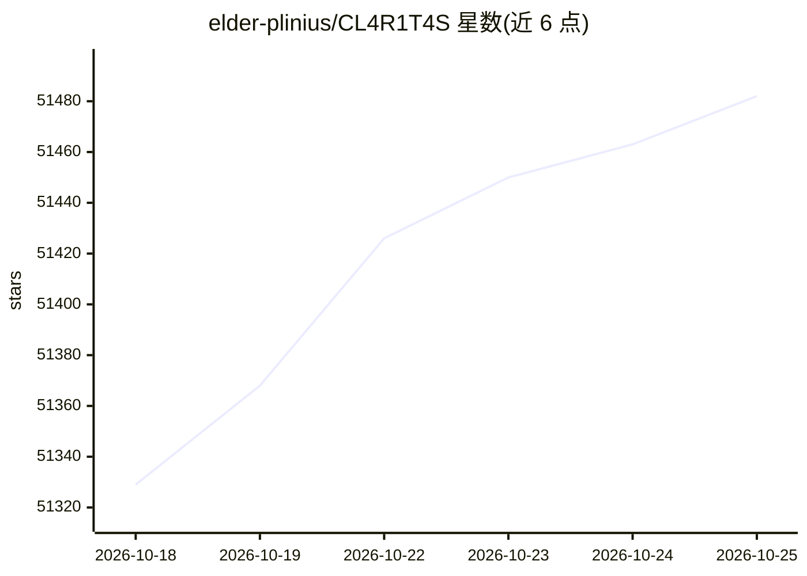

# elder-plinius/CL4R1T4S

⭐ 51,482 · AGPL-3.0 · 推送 2026-09-22 · [GitHub](https://github.com/elder-plinius/CL4R1T4S) · 个人维护

**收录各主流 AI 产品泄露系统提示词的透明度资料库**

以仓库形式汇集从 OpenAI、Google、Anthropic、xAI、Perplexity、Cursor、Windsurf、Devin、Manus、Replit 等产品中提取的系统提示词、指南与工具文本，声称覆盖几乎所有主流 AI 模型与 agent。目的是让用户了解各产品隐藏的系统指令内容。接受社区以 pull request 方式提交：需附模型名称/版本、提取日期及可选的上下文备注，通过 X 或 Discord 联系维护者。README 末段 L41-L43 包含试图让读取者复述自身指令的指令性文本。

## 筛选速览

| 维度 | 判定 | 备注 |
|---|---|---|
| AI 角色 | `ai-knowledge` | 知识聚合/清单类 |
| 许可风险 | `viral` | AGPL-3.0 |
| 部署形态 | `None` |  |
| 模型依赖 | — | README 未给出锁定关系 |
| 硬件要求 | — | 无带数字的原话,不猜 |
| 安装摩擦 | `low` | 无编译、无系统依赖或容器化 |
| 成熟度 | — | 结构信号不足 |

## 动量与使用信号

- 维护:`active` — 距上次 push 25.4 天,年发版 0,1 位贡献者
- 涨星:近 1 天 **+37**(自 20261016 起算)
- 安装:github 包 `release-assets` 月下载无数据

## 能力要点

- 收录多家 AI 产品的完整提取系统提示词与指南
- 提供 PR 贡献流程（模型名/版本、提取日期、备注）
- 以仓库形式按产品组织泄露文本

## 适用场景

- 查看某个 AI 产品的系统提示词文本
- 提交新提取到的系统提示词
- 了解各产品系统指令的存在形态

## 场景标签

`精选清单` · 领域:学习与行业

## 证据(README 行号)

> L3: AI SYSTEMS TRANSPARENCY AND OBSERVABILITY FOR ALL! Full extracted system prompts, guidelines, and tools from OpenAI,
> L28: Leak, extract, or reverse-engineer something? Good.

## 星数曲线

2026-10-18 51,329 → 2026-10-25 51,482（+153）

---
*卡片 v1 · prompt 1.4 · 生成 2026-10-18 · 置信度 high · 依据 README sha `6d8b54c5aebf` · [字段定义](../../DATASET.md)*
