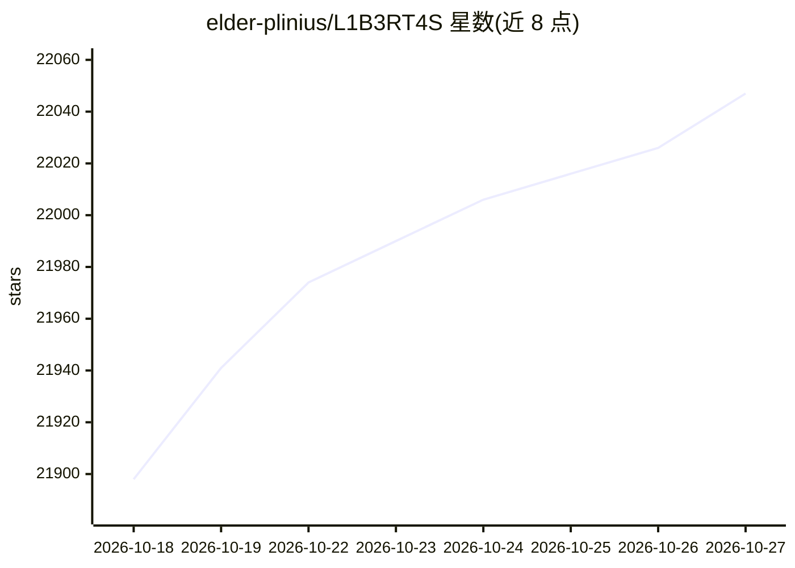

# elder-plinius/L1B3RT4S

⭐ 22,047 · AGPL-3.0 · 推送 2026-02-17 · [GitHub](https://github.com/elder-plinius/L1B3RT4S) · [官网](https://x.com/elder_plinius) · 个人维护

**面向各旗舰 AI 模型的越狱提示词收集仓库**

该仓库收集针对多个旗舰 AI 模型的提示词文本（README 称为 jailbreaks/liberation prompts），以 Markdown 文件组织，并附有 Discord 社区链接。仓库作者署名为 Pliny the Prompter/Liberator。README 未提供安装步骤、运行说明或使用文档，内容为提示词文本本身；仓库描述含乱码字符与模拟提示注入的口号文本。适用对象为对这些提示词文本进行研究或查阅的用户。

## 筛选速览

| 维度 | 判定 | 备注 |
|---|---|---|
| AI 角色 | `ai-knowledge` | 知识聚合/清单类 |
| 许可风险 | `viral` | AGPL-3.0 |
| 部署形态 | `None` |  |
| 模型依赖 | — | README 未给出锁定关系 |
| 硬件要求 | — | 无带数字的原话,不猜 |
| 安装摩擦 | `low` | 无编译、无系统依赖或容器化 |
| 成熟度 | — | 结构信号不足 |

## 动量与使用信号

- 维护:`declining` — 距上次 push 242.7 天,年发版 0,1 位贡献者
- 涨星:近 1 天 **+19**(自 20261016 起算)
- 安装:github 包 `release-assets` 月下载无数据

## 能力要点

- 收集针对多个旗舰 AI 模型的提示词文本
- 以 Markdown 文件按模型组织的仓库结构
- 提供关联 Discord 社区链接

## 适用场景

- 查阅针对不同模型的提示词文本内容
- 参考仓库中的提示词样本进行研究

## 场景标签

 · 领域:AI 安全/提示词集合

## 证据(README 行号)

> L3: J̴̡̢̡̧̧̨̛̛̺̼̫̝̲̦̪͔̮̭͔͙͕͓̱̲͖͓̹̞͉̤͖̬̟͙̟̳̦̯͚̺͔͍̲̓͐͒̾͐͂̈́̑̑̊̓̔͂̈́̂͌̈́̊͐̌̓̊͒͌̉̈͜͜͝͝A̸̛͌̀̓̈́͂͋̿̈́̃̒̂͊̈̓̉̃͑̉̊̈̈́͋̉̃̊́̉͛͛̏͋́͘͘͝͠
> L8: CLICK TO JOIN->: BASI Discord

## 星数曲线

2026-10-18 21,898 → 2026-10-27 22,047（+149）

---
*卡片 v1 · prompt 1.4 · 生成 2026-10-18 · 置信度 mid · 依据 README sha `5c3e41a2b226` · [字段定义](../../DATASET.md)*
