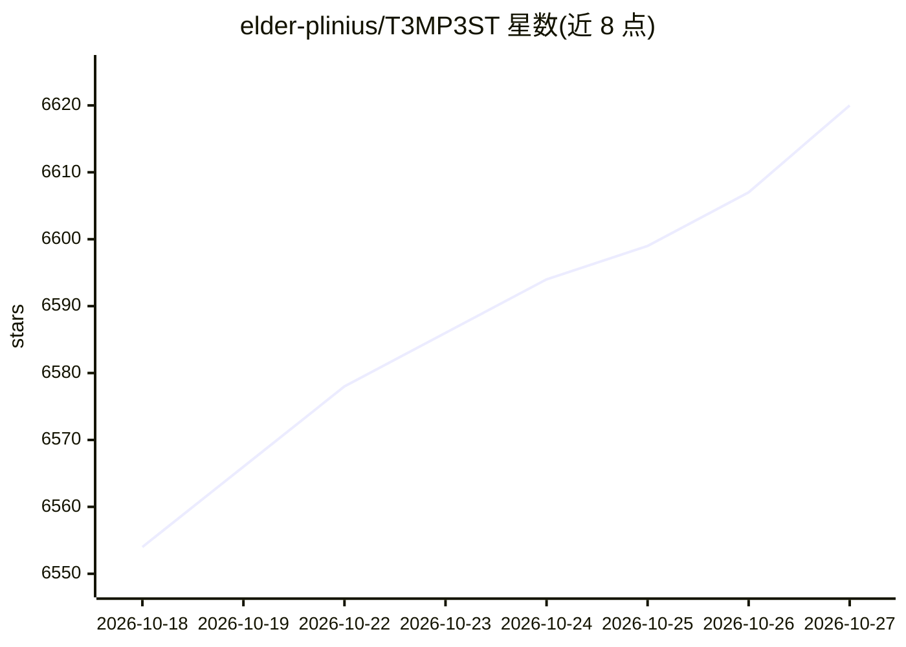

# elder-plinius/T3MP3ST

⭐ 6,620 · TypeScript · AGPL-3.0 · 推送 2026-09-08 · [GitHub](https://github.com/elder-plinius/T3MP3ST) · 个人维护

**多智能体红队框架：把已装的 AI 编码代理变成自动化渗透测试工具**

面向授权安全测试的多智能体进攻性安全框架：复用用户本机已有的 AI 编码代理（Claude Code、Codex、Hermes 等）或本地模型（Ollama/LM Studio/vLLM）作为执行核心，自动完成侦察→利用→报告的杀伤链，通过浏览器 War Room 或 CLI 操作，支持完全离线运行、无需新增 API key。覆盖 Web 应用、CTF、智能合约、源码分析、嵌入式等 7 类目标（成熟度不一，README 状态表标注 stable/scaffolding/roadmap）。提供 Docker Compose 部署与内置更新器，AGPL-3.0 许可，强调仅限授权目标。

## 筛选速览

| 维度 | 判定 | 备注 |
|---|---|---|
| AI 角色 | `ai-ecosystem` | LLM/agent 周边工具 |
| 许可风险 | `viral` | AGPL-3.0 |
| 部署形态 | `self-host` | docker 或自建部署 |
| 模型依赖 | local-ok | 支持本地模型 |
| 硬件要求 | — | 无带数字的原话,不猜 |
| 安装摩擦 | `low` | 无编译、无系统依赖或容器化 |
| 成熟度 | — | 结构信号不足 |

## 能力要点

- kill chain 自动化：recon → exploit → report，浏览器 War Room 与 CLI 两种入口
- 复用本机 AI 编码代理或离线模型（Ollama/LM Studio/vLLM），无需新增 API key
- README 声称所有数字可用 npm run verify-claims 从提交数据复现
- 状态表逐项标注 stable/scaffolding/roadmap，区分已实现与规划中功能

## 适用场景

- 在授权范围内对自有 Web 应用做自动化渗透测试
- 利用本地离线模型进行无外部依赖的安全测试
- 参与 CTF 挑战与开源软件漏洞挖掘（含协调披露流程）
- 复现与核验 README 中的基准测试数字

## 场景标签

`多智能体` `网络安全` · 领域:Agent 开发

## 证据(README 行号)

> L10: **A multi-agent offensive-security framework, built to turn the AI coding agent you already run into a zero-day hun
> L16: Point it at an authorized target and the kill chain runs itself: **recon → exploit → report**, from a browser War R
> L88: Or run it **fully offline** on your own model — no key, no cloud. Defaults to Ollama; point it at any OpenAI-compat

## 星数曲线

2026-10-18 6,554 → 2026-10-27 6,620（+66）

---
*卡片 v1 · prompt 1.4 · 生成 2026-10-20 · 置信度 high · 依据 README sha `910d4e9475e6` · [字段定义](../../DATASET.md)*
