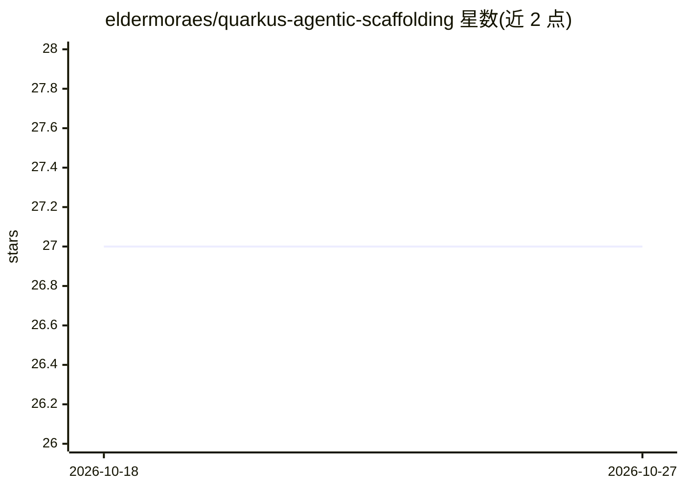

# eldermoraes/quarkus-agentic-scaffolding

⭐ 27 · Python · Apache-2.0 · 推送 2026-10-26 · [GitHub](https://github.com/eldermoraes/quarkus-agentic-scaffolding) · [官网](https://www.skills.sh/eldermoraes/quarkus-agentic-scaffolding) · 个人维护

**面向 Quarkus+LangChain4j 的 agent 脚手架技能与常驻规范包**

一个面向 Java 技术栈（Quarkus + LangChain4j）AI/agent 应用开发的分发产物：包含三个 Agent Skills（setup-agentic-scaffolding 校验工具链并注册 MCP 服务器、scaffold-project 生成项目与组件、audit-project 审计既有项目）以及常驻编码规范文件 CLAUDE.md/AGENTS.md。可通过 npx skills CLI 安装到 Claude Code、Codex、Gemini CLI、Copilot、Cursor 等兼容 agent，也提供各 agent 的插件安装路径。前置要求 JDK 25/GraalVM、JBang 与容器运行时。

## 筛选速览

| 维度 | 判定 | 备注 |
|---|---|---|
| AI 角色 | `ai-ecosystem` | LLM/agent 周边工具 |
| 许可风险 | `permissive` | Apache-2.0 |
| 部署形态 | `library` | 以包/库形式分发 |
| 模型依赖 | — | README 未给出锁定关系 |
| 硬件要求 | — | 无带数字的原话,不猜 |
| 安装摩擦 | `medium` | 含编译或系统依赖之一 |
| 成熟度 | — | 结构信号不足 |

## 能力要点

- 三个技能：工具链校验与 MCP 注册、项目脚手架、既有项目审计
- 常驻规范 CLAUDE.md（Claude）/AGENTS.md（Codex/Bob/Gemini）
- 支持 AI service、agent/workflow、RAG、MCP、guardrail 等组件脚手架
- npx skills add 一条命令安装到多个 skills 兼容 agent

## 适用场景

- 用 Claude Code/Codex 等 agent 快速生成 Quarkus+LangChain4j 项目骨架
- 为现有 Quarkus AI 项目添加 RAG 流水线或 agent 组件
- 按既定规范审计现有项目的一致性

## 场景标签

`代码生成` · 领域:编码与开发

## 证据(README 行号)

> L6: A small, opinionated, distribution-ready artifact for building AI and agent applications on the
> L40: - **`/scaffold-project`** — creates a new Quarkus + LangChain4j project end-to-end, and also

## 星数曲线

2026-10-18 27 → 2026-10-27 27（+0）

---
*卡片 v1 · prompt 1.4 · 生成 2026-10-26 · 置信度 high · 依据 README sha `ca12a737a15a` · [字段定义](../../DATASET.md)*
