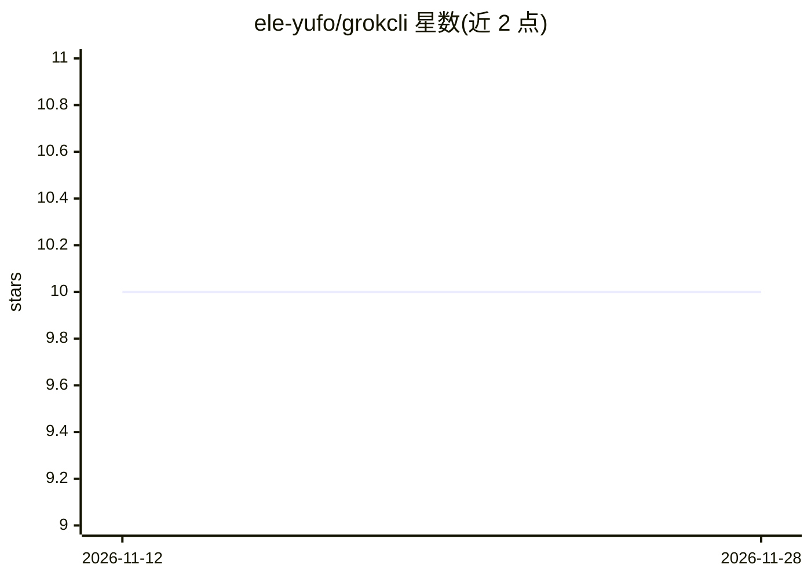

# ele-yufo/grokcli

⭐ 10 · Python · MIT · 推送 2026-10-21 · [GitHub](https://github.com/ele-yufo/grokcli) · 个人维护 · 中文 README

**通过 SuperGrok/X Premium+ 订阅 OAuth 使用 xAI Grok 全模态的零依赖 CLI**

用纯 Python 标准库编写的独立命令行工具，无需 API key 与第三方包，凭 SuperGrok 或 X Premium+ 订阅经浏览器 OAuth（PKCE）登录后调用 xAI 服务。命令覆盖聊天与推理、X/网页搜索并附引用、图像生成与编辑、文/图/参考图到视频及视频编辑与延长、TTS、语音转文字与自定义语音。为 agent 场景设计：stdout/stderr 分离、可输出 JSON、稳定的数字退出码、`grokcli help` 打印完整文档。会话本地持久化并可跨调用恢复；API base URL 锁定为 *.x.ai。

## 筛选速览

| 维度 | 判定 | 备注 |
|---|---|---|
| AI 角色 | `ai-ecosystem` | LLM/agent 周边工具 |
| 许可风险 | `permissive` | MIT |
| 部署形态 | `library` | 以包/库形式分发 |
| 模型依赖 | locked-api |  |
| 硬件要求 | — | 无带数字的原话,不猜 |
| 安装摩擦 | `low` | 无编译、无系统依赖或容器化 |
| 成熟度 | — | 结构信号不足 |

## 能力要点

- 零第三方依赖，纯 Python 3.9+ 标准库实现
- 订阅 OAuth 登录（PKCE），无需 API key，token 自动刷新并锁定仅发送到 *.x.ai
- 覆盖 chat/search/image/video/TTS/转写等全部 Grok 模态命令
- agent 友好：JSON 输出、数字退出码、内置自包含手册

## 适用场景

- 在终端直接用订阅账号与 Grok 对话、搜索并生成图像视频
- 在 agent/脚本流水线中以 JSON 与退出码机制调用 Grok 能力
- 将生成的媒体文件整理到本地输出目录

## 场景标签

`图像生成` `视频生成` `语音合成` `语音识别` · 领域:内容生成

## 证据(README 行号)

> L12:  Everything Grok. In your terminal. Zero dependencies.
> L32: |🎛️ **Every Grok modality, one command**|Chat & reasoning, X + web search with citations, image generation & editin
> L33: |🤖 **Built for agents**|Stable exit codes, `--output json`, and a fully self-contained manual — `grokcli help` prin

## 星数曲线

2026-11-12 10 → 2026-11-28 10（+0）

---
*卡片 v1 · prompt 1.4 · 生成 2026-11-19 · 置信度 high · 依据 README sha `6bf8306884de` · [字段定义](../../DATASET.md)*
