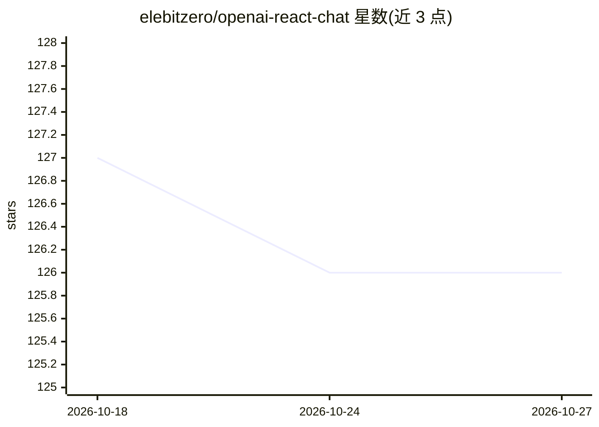

# elebitzero/openai-react-chat

⭐ 126 · TypeScript · MIT · 推送 2025-11-21 · [GitHub](https://github.com/elebitzero/openai-react-chat) · 个人维护

**面向开发者的 OpenAI API 网页聊天前端**

用 React、Tailwind CSS 和 TypeScript 编写的 Web 前端，连接 OpenAI chat API，目标是提供与 ChatGPT 和 OpenAI Playground 相近的功能，供希望自定义网页界面的开发者或高级用户使用。使用方式：git clone 源码，配置 local.env.json 中的 API key，经 npm install 与 npm run start 在本地 3000 端口运行；需要 Node.JS、npm 和 OpenAI API 账户，GPT-4 API 访问需完成至少一次付款。功能细节见 FEATURES.md。

## 筛选速览

| 维度 | 判定 | 备注 |
|---|---|---|
| AI 角色 | `ai-ecosystem` | LLM/agent 周边工具 |
| 许可风险 | `permissive` | MIT |
| 部署形态 | `library` | 以包/库形式分发 |
| 模型依赖 | — | README 未给出锁定关系 |
| 硬件要求 | — | 无带数字的原话,不猜 |
| 安装摩擦 | `low` | 无编译、无系统依赖或容器化 |
| 成熟度 | — | 结构信号不足 |

## 能力要点

- React + Tailwind CSS + TypeScript 技术栈的聊天前端
- 连接 OpenAI chat API，提供类 ChatGPT/Playground 功能
- 本地 npm 构建运行，自定义 API key 配置

## 适用场景

- 我想要一个可自定义界面的 ChatGPT 式网页前端
- 在本地接入自己的 OpenAI API key 进行对话测试

## 场景标签

`聊天机器人` · 领域:对话与助手

## 证据(README 行号)

> L3: This project provides a web frontend for the OpenAI chat API. This project is for developers or advanced users that 
> L5: * Provide the same features as OpenAI ChatGPT and

## 星数曲线

2026-10-18 127 → 2026-10-27 126（-1）

---
*卡片 v1 · prompt 1.4 · 生成 2026-10-23 · 置信度 high · 依据 README sha `4097ed768cf9` · [字段定义](../../DATASET.md)*
