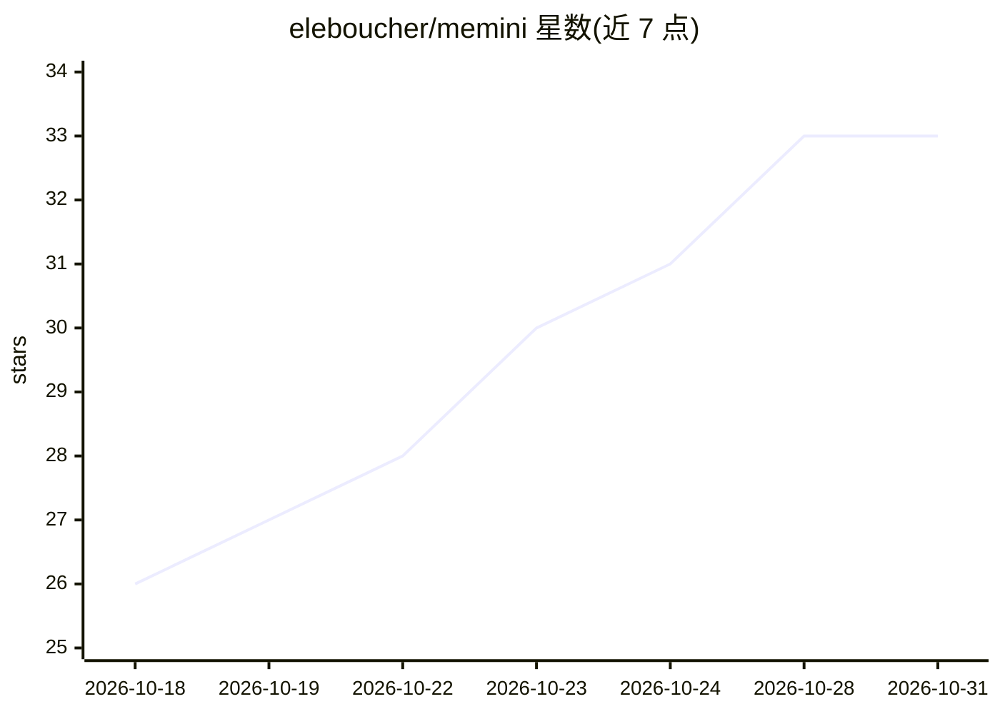

# eleboucher/memini

⭐ 33 · Go · AGPL-3.0 · 推送 2026-10-27 · [GitHub](https://github.com/eleboucher/memini) · 个人维护

**给 MCP 智能体提供持久分层记忆的 Go 单二进制服务**

面向 MCP-capable 智能体（Claude Code、Cursor、Codex、opencode 等）的共享持久记忆服务：提供 remember/recall 工具，采用分层记忆（working/episodic/semantic/procedural）与向量+关键词混合检索，RRF 融合后按相关性、访问新近度与重要性重排，recall 时折叠近重复。存储可插拔（嵌入式 sqlite-vec 或 Postgres+VectorChord），LLM 为可选（启用后台去重/矛盾消解，未启用走 marker 启发式）。接口含 REST、MCP（stdio 与 Streamable HTTP）及内嵌 Web UI；AGPL-3.0。

## 筛选速览

| 维度 | 判定 | 备注 |
|---|---|---|
| AI 角色 | `ai-ecosystem` | LLM/agent 周边工具 |
| 许可风险 | `viral` | AGPL-3.0 |
| 部署形态 | `None` |  |
| 模型依赖 | — | README 未给出锁定关系 |
| 硬件要求 | — | 无带数字的原话,不猜 |
| 安装摩擦 | `low` | 无编译、无系统依赖或容器化 |
| 成熟度 | — | 结构信号不足 |

## 能力要点

- 分层记忆（working/episodic/semantic/procedural）带衰减与混合检索（向量+BM25、RRF 融合）
- 单 Go 静态二进制，零配置启动，嵌入式 SQLite 到 Postgres 可插拔存储
- LLM 可选：无 LLM 时由 marker 启发式运行相同生命周期
- REST + MCP（stdio/Streamable HTTP）+ 内嵌 Web UI 共享同一服务层

## 适用场景

- 给 Claude Code / Cursor / Codex 等编码智能体加上跨会话持久记忆
- 多智能体按命名空间隔离共享记忆服务
- 从笔记本 SQLite 单机部署扩展到 Kubernetes 上的 Postgres 部署

## 场景标签

`Agent 记忆` `多智能体` · 领域:Agent 开发

## 证据(README 行号)

> L5: `memini` gives any MCP-capable agent (Claude Code, Cursor, Codex, opencode, Hermes, OpenClaw, Open WebUI) one place 
> L44: |Interfaces|REST + MCP (stdio and Streamable HTTP) + embedded web UI, sharing one service layer|
> L108: memini speaks the Model Context Protocol, over two transports:

## 星数曲线

2026-10-18 26 → 2026-10-31 33（+7）

---
*卡片 v1 · prompt 1.4 · 生成 2026-10-26 · 置信度 high · 依据 README sha `8b473d3749e7` · [字段定义](../../DATASET.md)*
