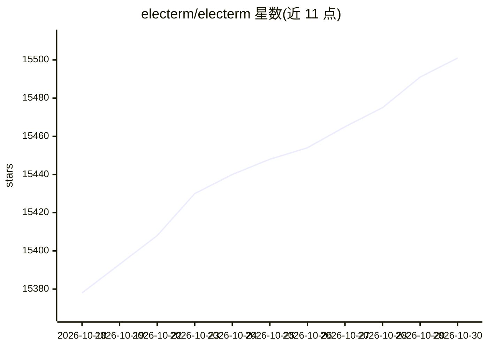

# electerm/electerm

⭐ 15,501 · JavaScript · MIT · 推送 2026-10-29 · [GitHub](https://github.com/electerm/electerm) · [官网](https://electerm.org) · 个人维护 · 中文 README

**跨平台终端/SSH/SFTP/RDP/VNC 客户端，带 AI 助手**

基于 Electron 的终端与远程连接客户端，支持 ssh/sftp/ftp/telnet/serialport/RDP/VNC/Spice 协议，覆盖 Linux/Mac/Windows/Android/HarmonyOS/iOS，兼容 UOS、Kylin、LoongArch、RISC-V 等系统。提供书签同步、隧道/跳板、Zmodem/Trzsz、代理、多语言等终端功能。AI 部分集成多 LLM API 格式（OpenAI Chat Completions/Responses、Anthropic Messages），提供命令建议、脚本编写、选中内容解释，以及 agent 模式直接执行终端操作，另有 MCP widget 供外部工具接入。

## 筛选速览

| 维度 | 判定 | 备注 |
|---|---|---|
| AI 角色 | `ai-enhanced` | 去掉 AI 部分产品仍成立 |
| 许可风险 | `permissive` | MIT |
| 部署形态 | `desktop` | 安装包/桌面程序 |
| 模型依赖 | — | README 未给出锁定关系 |
| 硬件要求 | — | 无带数字的原话,不猜 |
| 安装摩擦 | `low` | 无编译、无系统依赖或容器化 |
| 成熟度 | — | 结构信号不足 |

## 动量与使用信号

- 维护:`active` — 距上次 push 0.9 天,年发版 95,50 位贡献者
- 涨星:近 1 天 **+8**(自 20261016 起算)
- 安装:npm 包 `electerm` 月下载 4,275
- 平台:WINDOWS / MACOS / LINUX / ANDROID / IOS / WEB · 协议:OPENAI-API / MCP

## 能力要点

- AI 助手支持 OpenAI Chat Completions、OpenAI Responses、Anthropic Messages 三种 API 格式
- agent 模式可代为执行终端操作，支持创建书签/主题
- MCP widget 供 AI 助手与外部工具集成
- 支持 ssh 隧道、跳板连接、Zmodem/Trzsz、全局/会话代理

## 适用场景

- 在多平台统一管理 SSH/SFTP 远程连接与文件传输
- 让 AI 助手解释终端输出并生成命令/脚本
- 在 UOS/Kylin/LoongArch 等国产化环境使用终端客户端
- 通过 MCP 将终端能力接入外部 AI 工具

## 场景标签

`AI 助手` · 领域:对话与助手

## 证据(README 行号)

> L12: Open-sourced terminal/ssh/sftp/telnet/serialport/RDP/VNC/Spice/ftp client(Linux, Mac, Windows, Android, HarmonyOS, 
> L50: - AI assistant integration (supporting multiple LLM API formats — OpenAI Chat Completions, OpenAI Responses, and An
> L51: - MCP (Model Context Protocol) widget for AI assistants and external tools integration - see MCP Widget Usage Guide

## 星数曲线

2026-10-18 15,378 → 2026-10-30 15,501（+123）

---
*卡片 v1 · prompt 1.4 · 生成 2026-10-18 · 置信度 high · 依据 README sha `15076ab77d80` · [字段定义](../../DATASET.md)*
