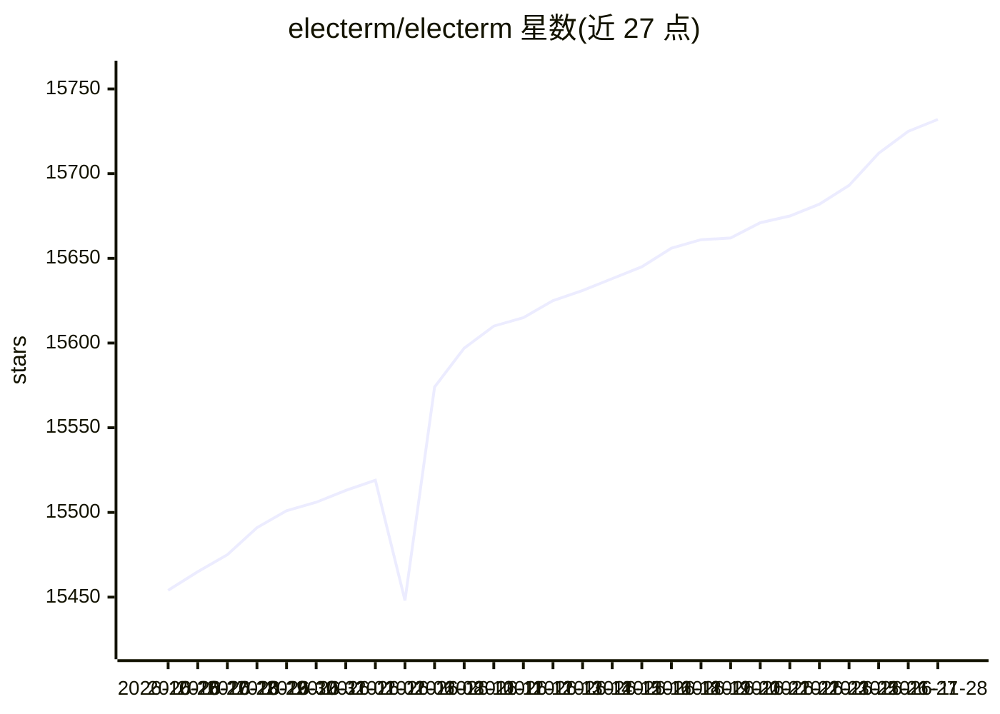

# electerm/electerm

⭐ 15,732 · JavaScript · MIT · 推送 2026-11-27 · [GitHub](https://github.com/electerm/electerm) · [官网](https://electerm.org) · 个人维护 · 中文 README

**跨平台终端/SSH/SFTP 客户端，含 AI 助手**

基于 Electron 的开源终端客户端，集终端、文件管理器与 ssh/sftp/ftp/telnet/serialport/RDP/VNC/Spice 客户端于一体，覆盖 Linux/macOS/Windows/Android/HarmonyOS/iOS，支持 UOS、Kylin、LoongArch、RISC-V、ppc64le 等平台。功能含多种 SSH 认证方式、隧道与连接跳板、Zmodem/Trzsz、书签同步、多语言 UI。AI 部分：集成多种 LLM API 格式的助手（命令建议、脚本编写、解释终端内容、Agent 模式直接执行终端操作），并提供 MCP widget 供 AI 助手与外部工具接入。

## 筛选速览

| 维度 | 判定 | 备注 |
|---|---|---|
| AI 角色 | `ai-enhanced` | 去掉 AI 部分产品仍成立 |
| 许可风险 | `permissive` | MIT |
| 部署形态 | `desktop` | 安装包/桌面程序 |
| 模型依赖 | — | README 未给出锁定关系 |
| 硬件要求 | — | 无带数字的原话,不猜 |
| 安装摩擦 | `low` | 无编译、无系统依赖或容器化 |
| 成熟度 | — | 结构信号不足 |

## 动量与使用信号

- 维护:`active` — 距上次 push 0.9 天,年发版 95,50 位贡献者
- 涨星:近 1 天 **+8**(自 20261016 起算)
- 安装:npm 包 `electerm` 月下载 4,275
- 平台:WINDOWS / MACOS / LINUX / ANDROID / IOS / WEB · 协议:OPENAI-API / MCP

## 能力要点

- 终端/文件管理器与 ssh/sftp/ftp/telnet/serialport/RDP/VNC/Spice 多协议客户端
- AI 助手支持 OpenAI Chat Completions、OpenAI Responses、Anthropic Messages 多种 API 格式，含 Agent 模式执行终端操作
- MCP widget 供 AI 助手与外部工具集成
- 支持多种认证方式、隧道、Zmodem/Trzsz、书签同步与多平台分发

## 适用场景

- 在 Linux/Mac/Windows 上统一管理 SSH/SFTP 远程连接与文件传输
- 通过 AI 助手获得命令建议、脚本编写与终端内容解释
- 让 Agent 模式直接代为执行终端操作
- 在 UOS/Kylin/LoongArch 等国产或特殊架构平台上使用终端工具

## 场景标签

`AI 助手` · 领域:对话与助手

## 证据(README 行号)

> L13: Open-sourced terminal/ssh/sftp/telnet/serialport/RDP/VNC/Spice/ftp client(Linux, Mac, Windows, Android, HarmonyOS, 
> L52: - AI assistant integration (supporting multiple LLM API formats — OpenAI Chat Completions, OpenAI Responses, and An

## 星数曲线

2026-10-26 15,454 → 2026-11-28 15,732（+278）

---
*卡片 v1 · prompt 1.4 · 生成 2026-11-28 · 置信度 high · 依据 README sha `71de85986a86` · [字段定义](../../DATASET.md)*
