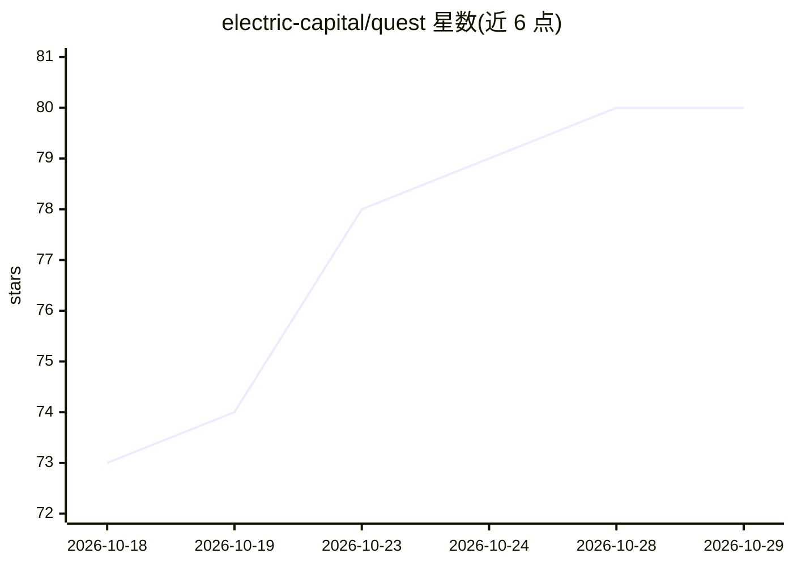

# electric-capital/quest

⭐ 80 · Python · Apache-2.0 · 推送 2026-10-28 · [GitHub](https://github.com/electric-capital/quest) · 组织维护

**自托管 AI agent 工作台：让非工程师安全地用 LLM 处理敏感数据**

自托管的 ChatGPT 式 Web 应用：用户通过 OAuth 或 API key 接入 Gmail、Slack、Drive、GitHub 等已有服务，让 LLM agent 在其上执行任务。面向需要在敏感内部数据上使用 AI 的用户，安全机制在服务端强制执行：私有/公开模式互斥（私有模式无出网通道，公开模式隔离内部资源）、脚本在无出网的 Podman 沙箱运行、写操作需人工批准卡片确认。支持多 LLM 提供商（Claude/OpenAI/Gemini/OpenRouter/Ollama 等）、插件式上游服务接入、技能库与子 agent。本地模式通过 run.py 一键启动，依赖 Python 3.11+ 与 Node.js 18+。

## 筛选速览

| 维度 | 判定 | 备注 |
|---|---|---|
| AI 角色 | `ai-native` | 本体是模型或模型工具 |
| 许可风险 | `permissive` | Apache-2.0 |
| 部署形态 | `None` |  |
| 模型依赖 | local-ok | 支持本地模型 |
| 硬件要求 | — | 无带数字的原话,不猜 |
| 安装摩擦 | `low` | 无编译、无系统依赖或容器化 |
| 成熟度 | — | 结构信号不足 |

## 能力要点

- 私有/公开模式互斥：会话不同时持有敏感数据与开放网络通道
- 写操作经 action request 人工批准（含 diff 预览），重启后待审批保留
- 多 LLM 提供商抽象（Claude/OpenAI/Gemini/Vertex/OpenRouter/Ollama/vLLM 等）
- 文件系统发现的插件架构接入上游服务，继承安全模型

## 适用场景

- 在企业内部邮件、文档、Slack 等敏感数据上运行 LLM agent
- 非工程师用户通过 Web UI 与审批卡片安全使用 AI agent
- 自托管部署并按用户管理凭据、功能开关与成本报表

## 场景标签

`AI 助手` `Agent 框架` · 领域:Agent 开发

## 证据(README 行号)

> L5: A self-hosted AI agent workbench: a ChatGPT-style web app where people connect the services they
> L17: Quest runs agentic conversations against multiple LLM providers and gives the agent carefully

## 星数曲线

2026-10-18 73 → 2026-10-29 80（+7）

---
*卡片 v1 · prompt 1.4 · 生成 2026-10-24 · 置信度 high · 依据 README sha `2c9474e8f16f` · [字段定义](../../DATASET.md)*
