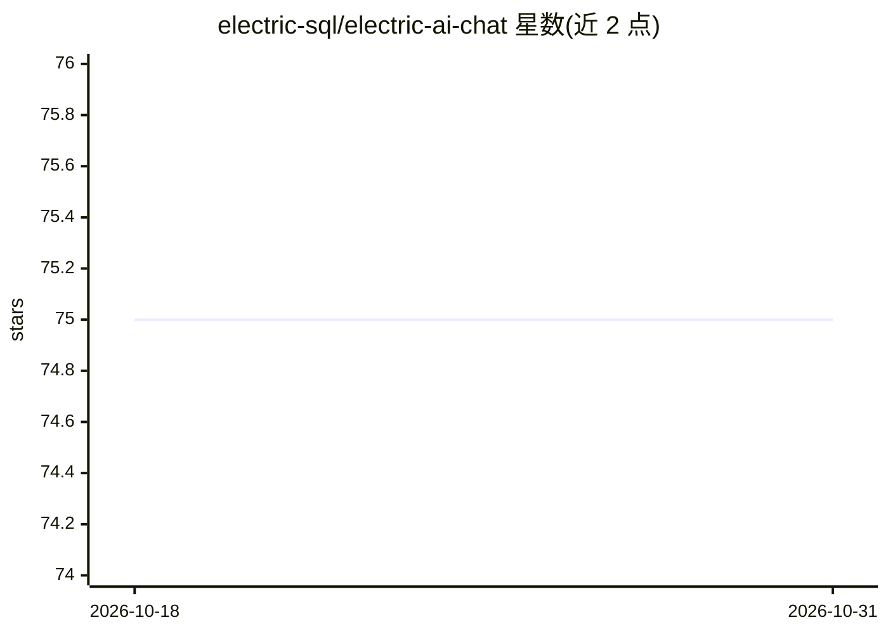

# electric-sql/electric-ai-chat

⭐ 75 · TypeScript · Apache-2.0 · 推送 2026-08-26 · [GitHub](https://github.com/electric-sql/electric-ai-chat) · [官网](https://electric-sql.com/blog/2025/04/09/building-ai-apps-on-sync) · 组织维护

**基于 Electric 同步引擎的多用户多 Agent 协作 AI 聊天演示应用**

ElectricSQL 团队发布的演示应用：展示如何在 Postgres 同步引擎 Electric 之上构建协作式 AI 聊天，实现多用户、多设备、多 Agent 实时同步，AI 会话的流式传输、断线重连与恢复，以及 LLM 工具响应的实时流式输出。后端调用 OpenAI API（含工具调用），实现文档检索、只读数据库查询、文件管理、聊天管理和协作待办清单等工具。技术栈为 React 19 + TypeScript + Hono + Postgres + ElectricSQL，通过 git clone 与 pnpm 本地运行，需 Docker、Node.js v18+ 与 OpenAI API key。在线演示已部署。

## 筛选速览

| 维度 | 判定 | 备注 |
|---|---|---|
| AI 角色 | `ai-native` | 本体是模型或模型工具 |
| 许可风险 | `permissive` | Apache-2.0 |
| 部署形态 | `self-host` | docker 或自建部署 |
| 模型依赖 | — | README 未给出锁定关系 |
| 硬件要求 | — | 无带数字的原话,不猜 |
| 安装摩擦 | `low` | 无编译、无系统依赖或容器化 |
| 成熟度 | — | 结构信号不足 |

## 能力要点

- 多用户/多设备/多 Agent 的实时会话同步与断线恢复
- LLM 工具响应的实时流式传输
- 实现 ElectricSQL 文档检索、只读 Postgres 查询、文件管理、协作待办等 5 类 LLM 工具
- 待办事项由用户或 AI 创建，跨客户端双向实时同步

## 适用场景

- 参考如何用同步引擎构建可恢复、多用户的 AI 聊天应用
- 学习 LLM 工具调用与实时协作 UI 的集成模式
- 体验 Electric 的部分复制与 shape streams 事件驱动架构

## 场景标签

`聊天机器人` `教程课程` · 领域:对话与助手

## 证据(README 行号)

> L11: This is a demo application that shows how to build collaborative AI apps that use Electric to keep both agents and 
> L14: - live streaming of AI sessions with seamless resumeability and session continuity
> L93:  - OpenAI API with tool calling capabilities

## 星数曲线

2026-10-18 75 → 2026-10-31 75（+0）

---
*卡片 v1 · prompt 1.4 · 生成 2026-10-24 · 置信度 mid · 依据 README sha `2fca9118fc46` · [字段定义](../../DATASET.md)*
