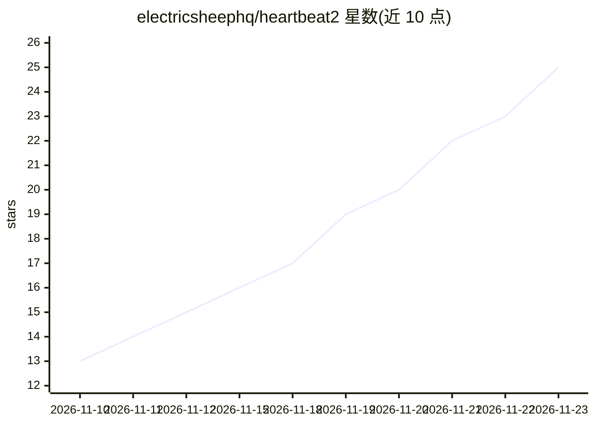

# electricsheephq/heartbeat2

⭐ 25 · Python · Apache-2.0 · 推送 2026-11-21 · [GitHub](https://github.com/electricsheephq/heartbeat2) · 组织维护

**让 Hermes agent 在消息间隙自主工作的唤醒/监视器插件**

面向 Hermes agent 的插件（HeartBeat 2.0），通过 wakes（定时/条件唤醒）、watchers（对文件、进程、URL、只读命令或 Hermes 事件的确定性监视）与 roles（带章程和节奏的长期职责），让 agent 在用户不发消息时也能自主工作并在有事时主动发消息。调度与声明持久化于 SQLite 墙钟时间，每会话每日的模型轮次、消息数与可选花费上限由用户设定；watcher 在条件满足前不消耗模型调用。需 Hermes ≥ 0.21.6 与消息网关（Telegram/Discord/Slack/WhatsApp 等）或 0.23+ 的 Desktop/TUI，Python ≥ 3.11。以 hermes plugins 命令安装。

## 筛选速览

| 维度 | 判定 | 备注 |
|---|---|---|
| AI 角色 | `ai-ecosystem` | LLM/agent 周边工具 |
| 许可风险 | `permissive` | Apache-2.0 |
| 部署形态 | `None` |  |
| 模型依赖 | — | README 未给出锁定关系 |
| 硬件要求 | — | 无带数字的原话,不猜 |
| 安装摩擦 | `low` | 无编译、无系统依赖或容器化 |
| 成熟度 | — | 结构信号不足 |

## 能力要点

- wakes/watchers/roles 三类机制，agent 可在消息间隙自主工作并主动发消息
- watchers 条件满足前不产生模型调用；空转唤醒自动退避并暂停
- SQLite 持久化调度，每日轮次/消息/花费上限与静默时段等防护栏
- 唤醒只能返回发起它的会话，无目标参数

## 适用场景

- 让 agent 监视构建日志/URL/进程，变化时主动汇报
- 给 agent 指派长期职责（如负责发布说明），由其自行安排节奏
- 定时提醒、周期检查与长时间沉默后的回访

## 场景标签

`工作流自动化` · 领域:效率与自动化

## 证据(README 行号)

> L5: **Give your Hermes agent a working life between messages: wakes, watchers and roles, within daily turn and message c
> L19: It needs Hermes ≥ 0.21.6 with a messaging gateway (Telegram, Discord, Slack, WhatsApp and the other gateway platfor
> L43: - **Follow-ups and watchers.** A follow-up at a set time, a recurring check, a check-in after a long silence, or a 

## 星数曲线

2026-11-10 13 → 2026-11-23 25（+12）

---
*卡片 v1 · prompt 1.4 · 生成 2026-11-18 · 置信度 high · 依据 README sha `a3a749a06482` · [字段定义](../../DATASET.md)*
