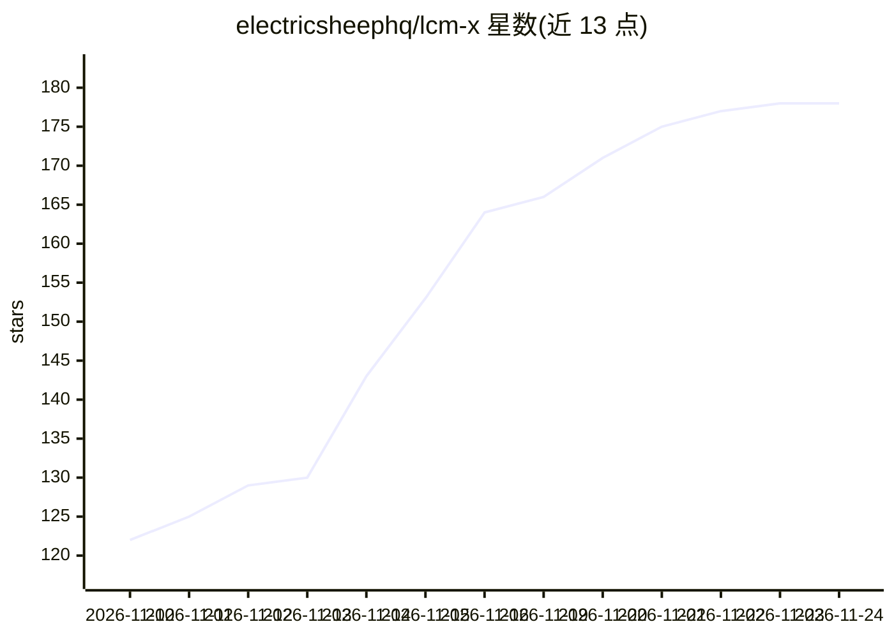

# electricsheephq/lcm-x

⭐ 178 · Python · MIT · 推送 2026-11-22 · [GitHub](https://github.com/electricsheephq/lcm-x) · [官网](https://losslesscontext.com/) · 组织维护

**Hermes Agent 的无损记忆上下文引擎插件**

面向 Hermes Agent 的上下文引擎插件：将全部对话轮次持久化到本地 SQLite 存储，用深度感知摘要节点与分层 DAG 压缩旧上下文，保持活跃提示有界，并通过 16 个 lcm_* 工具让 agent 检索、检查与展开被压缩的内容。支持源血缘过滤、会话控制、大负载外置化、时间性记忆及语义检索（本地 FastEmbed，可选 Voyage/OpenAI 兼容/Ollama 嵌入）。要求 Hermes 0.21.3+ 与 Python 3.11+，默认无第三方运行时依赖、无需 API key；另提供面向 Claude Code 的变体。默认无损，敏感信息脱敏等丢弃行为均为 opt-in。

## 筛选速览

| 维度 | 判定 | 备注 |
|---|---|---|
| AI 角色 | `ai-ecosystem` | LLM/agent 周边工具 |
| 许可风险 | `permissive` | MIT |
| 部署形态 | `library` | 以包/库形式分发 |
| 模型依赖 | local-ok | 支持本地模型 |
| 硬件要求 | — | 无带数字的原话,不猜 |
| 安装摩擦 | `low` | 无编译、无系统依赖或容器化 |
| 成熟度 | — | 结构信号不足 |

## 能力要点

- SQLite 消息持久化 + 摘要 DAG 的有界上下文引擎
- 16 个 lcm_* 工具支持检索/展开/溯源/诊断
- 本地默认路径无需 API key，语义检索可选 Ollama/Voyage 等后端
- 面向 Claude Code 的独立变体与只读读取服务器

## 适用场景

- 长会话 agent 不丢失被压缩的历史细节，可随时回查原文
- 控制活跃提示 token 预算同时保留完整审计记录
- 在 Claude Code 中复用本地无损记忆存储

## 场景标签

`Agent 记忆` · 领域:Agent 开发

## 证据(README 行号)

> L3: Lossless memory for Hermes Agent: every turn kept in a local store, not compacted away, and searchable by your agent
> L80: LCM-X replaces one-shot active-context compression with a SQLite-backed,
> L121: 1. **Persists messages** in a plugin-local SQLite store with FTS metadata.

## 星数曲线

2026-11-10 122 → 2026-11-24 178（+56）

---
*卡片 v1 · prompt 1.4 · 生成 2026-11-17 · 置信度 mid · 依据 README sha `332d7db03266` · [字段定义](../../DATASET.md)*
