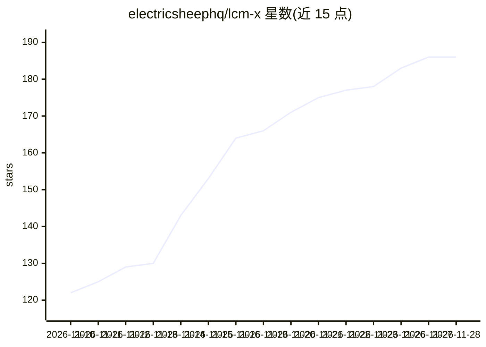

# electricsheephq/lcm-x

⭐ 186 · Python · MIT · 推送 2026-11-27 · [GitHub](https://github.com/electricsheephq/lcm-x) · [官网](https://losslesscontext.com/) · 组织维护

**为 Hermes Agent 提供无损记忆的本地上下文引擎插件**

以 Hermes 插件形式安装的上下文引擎，用插件本地 SQLite 存储（含 FTS 元数据）保留每轮原始消息，替代一次性压缩：旧上下文折叠为深度感知的摘要节点并组成层级 DAG，活动提示由系统提示、高价值摘要与受保护新鲜尾部组装；提供 13 个默认召回工具（如 lcm_recall、lcm_grep、lcm_status）供 agent 搜索与展开被压缩内容。默认本地配置无需 API key，语义检索默认用进程内 FastEmbed，可选 Voyage、OpenAI 兼容或 Ollama 后端。要求 Hermes ≥ 0.21.3。

## 筛选速览

| 维度 | 判定 | 备注 |
|---|---|---|
| AI 角色 | `ai-ecosystem` | LLM/agent 周边工具 |
| 许可风险 | `permissive` | MIT |
| 部署形态 | `library` | 以包/库形式分发 |
| 模型依赖 | local-ok | 支持本地模型 |
| 硬件要求 | — | 无带数字的原话,不猜 |
| 安装摩擦 | `low` | 无编译、无系统依赖或容器化 |
| 成熟度 | — | 结构信号不足 |

## 能力要点

- SQLite 原始消息存储 + 层级摘要 DAG 的无损上下文机制
- 13 个默认召回工具支持分页检索，不淹没主提示
- 敏感模式脱敏、会话忽略、大负载外部化等控制项
- 默认本地 FastEmbed 语义检索，可选 Voyage/OpenAI 兼容/Ollama

## 适用场景

- 长会话中让 agent 随时检索被压缩的原始对话细节
- 保持 Hermes Agent 提示长度有界但不丢失历史轮次
- 对存储内容做敏感信息脱敏与会话过滤

## 场景标签

`Agent 记忆` · 领域:Agent 开发

## 证据(README 行号)

> L3: Lossless memory for Hermes Agent: every turn kept in a local store, not compacted away, and searchable by your agent
> L80: LCM-X replaces one-shot active-context compression with a SQLite-backed,
> L82: messages, and gives the agent tools to recover exact detail after compaction.
> L110: Hermes Agent's built-in compressor is a practical continuity layer: when the

## 星数曲线

2026-11-10 122 → 2026-11-28 186（+64）

---
*卡片 v1 · prompt 1.4 · 生成 2026-11-26 · 置信度 mid · 依据 README sha `ba50f9d6b384` · [字段定义](../../DATASET.md)*
