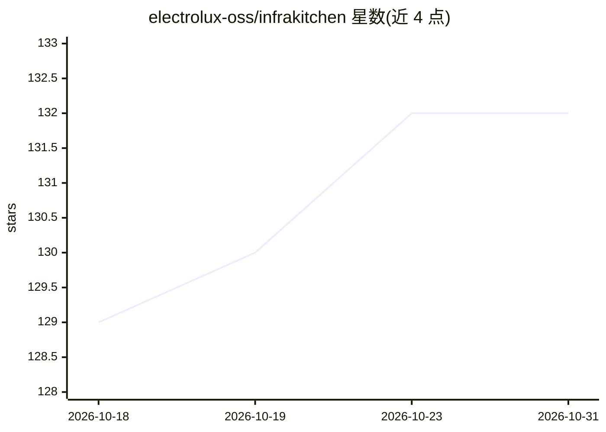

# electrolux-oss/infrakitchen

⭐ 132 · Python · Apache-2.0 · 推送 2026-10-30 · [GitHub](https://github.com/electrolux-oss/infrakitchen) · [官网](https://opensource.electrolux.one/infrakitchen) · 组织维护

**面向平台工程的开源开发者平台：模板化自助云资源管理**

InfraKitchen 是一个开源开发者平台，将平台工程实践应用于基础设施管理。平台团队（SRE/基础设施团队）创建并持续维护版本化的基础设施即代码模板（golden path，覆盖网络、数据库、Kubernetes 集群等），开发者通过 UI 或 Pull Request 自助开通云资源并随模板版本演进更新。提供集中治理：标准、安全策略、合规规则与完整审计记录。README 未展示具体 AI 功能；入门方式为查阅文档与示例模板仓库。

## 筛选速览

| 维度 | 判定 | 备注 |
|---|---|---|
| AI 角色 | `ai-enhanced` | 去掉 AI 部分产品仍成立 |
| 许可风险 | `permissive` | Apache-2.0 |
| 部署形态 | `None` |  |
| 模型依赖 | — | README 未给出锁定关系 |
| 硬件要求 | — | 无带数字的原话,不猜 |
| 安装摩擦 | `low` | 无编译、无系统依赖或容器化 |
| 成熟度 | — | 结构信号不足 |

## 能力要点

- 版本化的基础设施即代码模板（golden path）
- 开发者通过 UI 或 Pull Request 自助开通云资源
- 集中执行标准、安全策略与合规规则，含完整审计记录

## 适用场景

- 平台团队沉淀标准化基础设施模板供开发者复用
- 开发者自助开通云资源，减少基础设施工单
- 组织内统一执行基础设施合规与审计

## 场景标签

 · 领域:基础设施/开发者平台

## 证据(README 行号)

> L13: InfraKitchen is an open source Developer Platform that brings Platform Engineering practices to infrastructure mana

## 星数曲线

2026-10-18 129 → 2026-10-31 132（+3）

---
*卡片 v1 · prompt 1.4 · 生成 2026-10-23 · 置信度 low · 依据 README sha `6547082ee4b1` · [字段定义](../../DATASET.md)*
