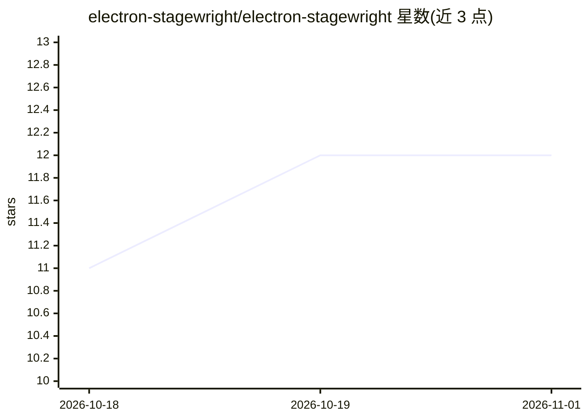

# electron-stagewright/electron-stagewright

⭐ 12 · TypeScript · MIT · 推送 2026-10-31 · [GitHub](https://github.com/electron-stagewright/electron-stagewright) · [官网](https://electron-stagewright.github.io/electron-stagewright/) · 组织维护

**让 AI agent 通过 MCP 驱动真实 Electron 应用的测试服务器**

面向 Electron 桌面应用的 MCP（Model Context Protocol）服务器，供 Claude Code、Codex、Cursor、Cline、Aider 等 MCP 兼容 agent 启动/附加到真实 Electron 应用，基于无障碍树（ARIA 角色而非 CSS 选择器）进行检查、交互与断言。为 agent 会话设计：错误自带提示、每次响应报告 token 成本、单次 get_state 返回完整状态、expect_* 断言带重试、快照差异可增量返回。支持附加运行中的主进程、可确定性重放并带 token 预算的会话 trace、以及签名/公证包的端到端校验。需 Node.js 24+，Linux 上需显示环境；默认经 Playwright 与 Electron 运行时启动。

## 筛选速览

| 维度 | 判定 | 备注 |
|---|---|---|
| AI 角色 | `ai-ecosystem` | LLM/agent 周边工具 |
| 许可风险 | `permissive` | MIT |
| 部署形态 | `desktop` | 安装包/桌面程序 |
| 模型依赖 | — | README 未给出锁定关系 |
| 硬件要求 | — | 无带数字的原话,不猜 |
| 安装摩擦 | `low` | 无编译、无系统依赖或容器化 |
| 成熟度 | — | 结构信号不足 |

## 能力要点

- 基于无障碍树语义查询（electron_find），不依赖 CSS/XPath
- agent 优先设计：错误带恢复提示、响应自报 token 成本、expect_* 断言单次调用
- 支持附加运行中的主进程（Node Inspector 注入）与打包签名 .app 的端到端校验
- 会话 trace 可确定性重放，支持 per-tool token 预算

## 适用场景

- 用 Claude Code/Cursor 等 agent 对自己的 Electron 应用做 E2E 测试
- 对已运行的开发服务器附加会话，不重启应用
- 校验签名、公证后的发布包（codesign/Gatekeeper/autoUpdater）
- 为 agent 回放会话 trace 并控制 token 预算

## 场景标签

`GUI 自动化` · 领域:效率与自动化

## 证据(README 行号)

> L10: Electron Stagewright is a Model Context Protocol (MCP) server that lets Claude Code, Codex, Cursor,
> L11: Cline, Aider, and any MCP-compatible agent operate real Electron applications. Launch or attach,
> L66: claude mcp add electron-stagewright -- \

## 星数曲线

2026-10-18 11 → 2026-11-01 12（+1）

---
*卡片 v1 · prompt 1.4 · 生成 2026-11-01 · 置信度 high · 依据 README sha `9f8bb63660c3` · [字段定义](../../DATASET.md)*
