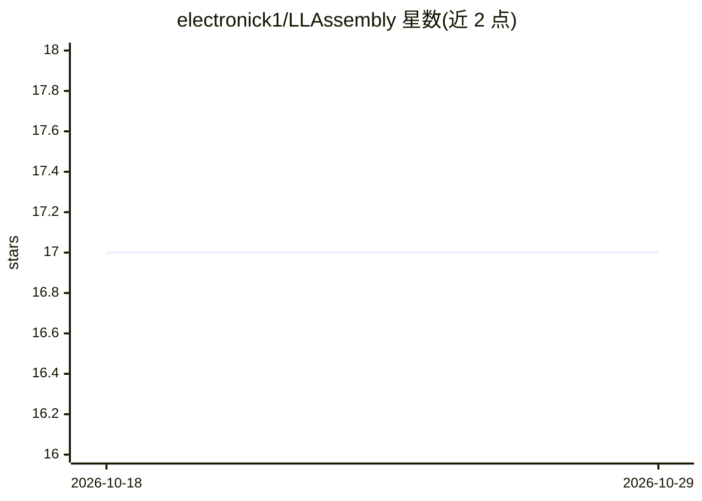

# electronick1/LLAssembly

⭐ 17 · Python · MIT · 推送 2026-09-03 · [GitHub](https://github.com/electronick1/LLAssembly) · 个人维护

**LLM agent 工具编排库：用汇编式计划一次生成执行全流程**

面向 LLM agent 开发者的工具编排库：让模型一次性生成含条件、循环与状态跟踪的汇编式执行计划，再由轻量模拟器执行并在此过程中调用工具，从而把多步工具调用压缩为单次 LLM 请求。汇编指令被转换为 LangGraph 子图节点执行，寄存器/栈可存任意类型值，默认指令上限 1000 防止死循环。支持 LangChain 中间件与 LangGraph 节点两种接入方式，提供同步/异步调用，PydanticAI 支持为 WIP。项目自述处于开发中、可能不稳定，新版将含破坏性变更。

## 筛选速览

| 维度 | 判定 | 备注 |
|---|---|---|
| AI 角色 | `ai-ecosystem` | LLM/agent 周边工具 |
| 许可风险 | `permissive` | MIT |
| 部署形态 | `library` | 以包/库形式分发 |
| 模型依赖 | local-ok | 支持本地模型 |
| 硬件要求 | — | 无带数字的原话,不猜 |
| 安装摩擦 | `low` | 无编译、无系统依赖或容器化 |
| 成熟度 | `idea` | |

## 能力要点

- 单次 LLM 请求生成含条件/循环/状态跟踪的完整执行计划
- 汇编指令转换为 LangGraph 子图节点并由模拟器执行工具调用
- 支持 LangChain（中间件）与 LangGraph（同步/异步节点）接入
- 指令执行上限 1000、自定义提示词与执行日志等可配置项

## 适用场景

- 游戏 NPC 通过自然语言指令在变化环境中执行带条件的动作序列
- 机器人场景中减少传感器决策的 LLM 往返延迟
- 代码助手或自动化工作流中编排多工具分支逻辑并控制请求成本

## 场景标签

`Agent 框架` · 领域:Agent 开发

## 证据(README 行号)

> L3: LLAssembly is a tool-orchestration library for LLM agents.
> L18: Currently following libs/frameworks supported:
> L70: Currently LLAssembly supports LangChain and LangGraph. When you invoke the agent:

## 星数曲线

2026-10-18 17 → 2026-10-29 17（+0）

---
*卡片 v1 · prompt 1.4 · 生成 2026-10-29 · 置信度 high · 依据 README sha `a5c8a0c30202` · [字段定义](../../DATASET.md)*
