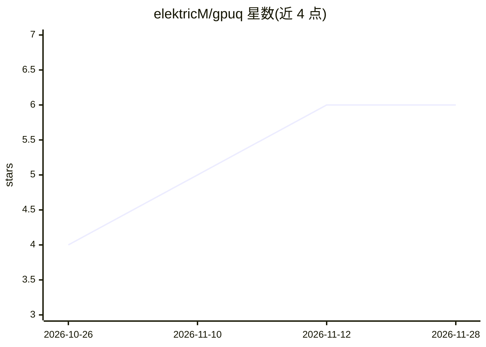

# elektricM/gpuq

⭐ 6 · Rust · GPL-3.0 · 推送 2026-11-10 · [GitHub](https://github.com/elektricM/gpuq) · 个人维护

**Linux GPU 调度器：排队共享显卡，防 VRAM 溢出**

面向 Linux 单机/多 GPU 的调度守护进程：按优先级与空闲 VRAM 排队任务，任务放不下时通过卸载 LLM 服务端模型、经 systemd/Docker/Podman 停服务或发信号让低优先级任务退出腾出空间；对 Ollama、ComfyUI 等服务器提供 HTTP 门控，客户端无需感知。适用于家用服务器、游戏 PC 兼跑本地 AI、实验室共用机器。经 install.sh 静态二进制、deb/rpm 包或 cargo 安装，需 Rust 1.80+ 从源码构建。项目自述处于早期开发，配置格式在 1.0 前可能变动。

## 筛选速览

| 维度 | 判定 | 备注 |
|---|---|---|
| AI 角色 | `ai-ecosystem` | LLM/agent 周边工具 |
| 许可风险 | `viral` | GPL-3.0 |
| 部署形态 | `desktop` | 安装包/桌面程序 |
| 模型依赖 | local-ok | 支持本地模型 |
| 硬件要求 | — | 无带数字的原话,不猜 |
| 安装摩擦 | `low` | 无编译、无系统依赖或容器化 |
| 成熟度 | `idea` | |

## 能力要点

- 优先级队列与 VRAM 记账，放得下的任务可共享一张卡
- 卸载 Ollama/llama.cpp/vLLM 等服务端模型以腾出显存
- HTTP 门控在 LLM 服务器前拦截请求，客户端无需改动
- AMD 与 NVIDIA GPU 统一检测与调度，可选停止/迁移桌面

## 适用场景

- 家用服务器上 Ollama、ComfyUI 与 Whisper 共享一张卡
- 游戏 PC 的显卡同时跑本地 AI 任务
- 实验室多人共用 GPU 机器按优先级排队
- 渲染、视频编码等非 AI 计算任务也纳入同一队列

## 场景标签

 · 领域:系统工具/GPU 资源调度

## 证据(README 行号)

> L6: gpuq lets several programs share your GPUs without running out of VRAM: it queues jobs,
> L27: gpuq is a scheduler for Linux machines with one or more GPUs that hands the cards out in turn,
> L59: gpuq works with any program that uses the GPU, not only AI tools: renders, video encodes,

## 星数曲线

2026-10-26 4 → 2026-11-28 6（+2）

---
*卡片 v1 · prompt 1.4 · 生成 2026-11-20 · 置信度 mid · 依据 README sha `00b3d5cabd49` · [字段定义](../../DATASET.md)*
