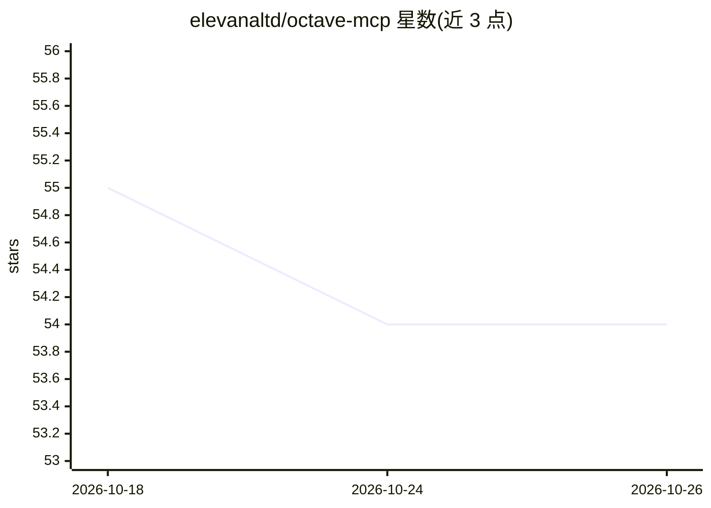

# elevanaltd/octave-mcp

⭐ 54 · Python · Apache-2.0 · 推送 2026-10-03 · [GitHub](https://github.com/elevanaltd/octave-mcp) · 组织维护

**LLM 结构化文档基础设施：OCTAVE 格式 MCP 服务器与 CLI**

面向 LLM 管道的确定性文档基础设施：定义 OCTAVE 结构化文档格式（标记字段+神话术语压缩词汇），提供 MCP 服务器与 CLI，功能包括规范化（幂等、字节级一致）、带回执的 schema 校验、三档压缩与损耗声明、GBNF 语法编译（供 llama.cpp 系后端解码时约束生成）、YAML frontmatter 一并校验与字面区直通。通过 stdio 或 HTTP 传输接入 Claude Code/Claude Desktop 等 MCP 客户端，Python 3.11+，pip 安装，Apache-2.0 许可。神话压缩部分自述为探索性假设，提供复现协议。

## 筛选速览

| 维度 | 判定 | 备注 |
|---|---|---|
| AI 角色 | `ai-ecosystem` | LLM/agent 周边工具 |
| 许可风险 | `permissive` | Apache-2.0 |
| 部署形态 | `library` | 以包/库形式分发 |
| 模型依赖 | — | README 未给出锁定关系 |
| 硬件要求 | — | 无带数字的原话,不猜 |
| 安装摩擦 | `low` | 无编译、无系统依赖或容器化 |
| 成熟度 | `idea` | |

## 能力要点

- 幂等规范化：同输入同输出，两 agent 独立产出可字节级一致
- schema 校验带修复回执，文档自带 schema/压缩档/变换日志
- META.CONTRACT 编译为 GBNF 语法，供 llama.cpp 系后端解码期约束生成
- stdio 与 HTTP 双传输（含 DNS rebinding 防护与健康检查）

## 适用场景

- 多 agent 间传递需要保持事实不丢失的文档
- 对决策日志、审计记录做可追溯的结构化存储
- 用 GBNF 语法在解码期约束 LLM 生成合法 OCTAVE 文档

## 场景标签

 · 领域:LLM 基础设施/结构化文档

## 证据(README 行号)

> L8: **Deterministic document infrastructure for LLM pipelines.** Canonicalization, schema validation, grammar compilatio
> L74: - **HTTP + stdio transport** — Stdio by default, Streamable HTTP with DNS rebinding protection and health checks fo
> L95: ### MCP Tools

## 星数曲线

2026-10-18 55 → 2026-10-26 54（-1）

---
*卡片 v1 · prompt 1.4 · 生成 2026-10-24 · 置信度 high · 依据 README sha `860e75f2013a` · [字段定义](../../DATASET.md)*
