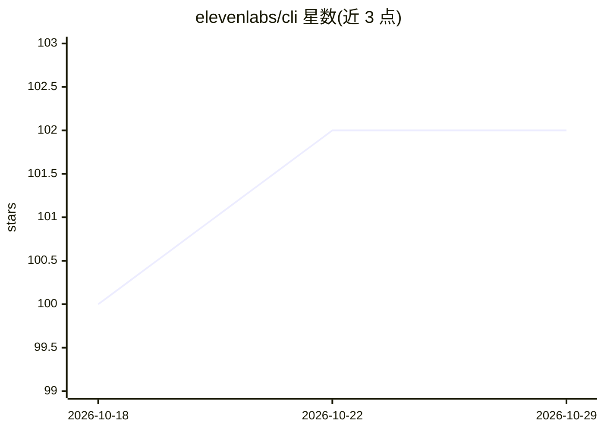

# elevenlabs/cli

⭐ 102 · Rust · MIT · 推送 2026-10-28 · [GitHub](https://github.com/elevenlabs/cli) · [官网](https://www.elevenlabs.io) · 组织维护

**ElevenLabs 平台命令行工具：全 API 访问与 Agent 配置管理**

Rust 编写的 ElevenLabs 平台 CLI：将每个 API 端点暴露为子命令（elevenlabs <resource> <method>），支持 say 命令在终端直接文本转语音并调用本地播放器播放；核心功能 Agents as Code 通过本地 JSON 配置文件管理 Conversational AI agent，提供 init/add/push/pull 同步、模板（default/minimal/customer-service 等）、工具与测试注册；另含 Flows 异步任务轮询（create-and-wait）、数据驻留区域切换与 UI 组件安装。需 ElevenLabs API key 认证。

## 筛选速览

| 维度 | 判定 | 备注 |
|---|---|---|
| AI 角色 | `ai-ecosystem` | LLM/agent 周边工具 |
| 许可风险 | `permissive` | MIT |
| 部署形态 | `library` | 以包/库形式分发 |
| 模型依赖 | — | README 未给出锁定关系 |
| 硬件要求 | — | 无带数字的原话,不猜 |
| 安装摩擦 | `high` | 编译与系统依赖俱全 |
| 成熟度 | — | 结构信号不足 |

## 能力要点

- 每个 ElevenLabs API 端点均可作为 CLI 子命令调用
- Agents as Code：本地 JSON 配置与平台 push/pull 无损同步
- say 命令文本转语音并调用本机播放器（ffplay/mpv/afplay 等）
- 提供 --dry-run、--page-all 自动分页、多种输出格式等通用 flags

## 适用场景

- 在终端或脚本中调用 ElevenLabs 语音与 Conversational AI API
- 以配置文件版本化管理 agent、工具与测试并同步到平台
- 在 CI 或工作流中等待 Flows 图像/视频/TTS 任务完成

## 场景标签

`语音合成` · 领域:内容生成

## 证据(README 行号)

> L9: - **Full API access** — every ElevenLabs API endpoint is available as a subcommand (`elevenlabs <resource> <method>`
> L10: - **Agents as Code** — manage Conversational AI agents from local configuration files, with templates, branches, an
> L145: Manage Conversational AI agents from local configuration files. `elevenlabs agents init` scaffolds a project; agen

## 星数曲线

2026-10-18 100 → 2026-10-29 102（+2）

---
*卡片 v1 · prompt 1.4 · 生成 2026-10-23 · 置信度 high · 依据 README sha `aaa44014ab07` · [字段定义](../../DATASET.md)*
